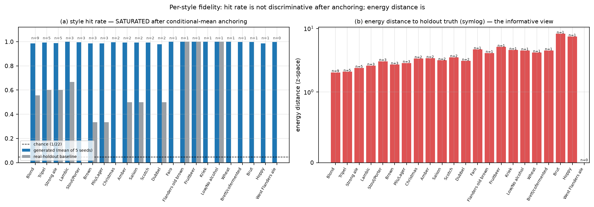

# 摘要 {-}

本文件只用于验证 Markdown → TeX → PDF 管道可用，不含任何研究结论。正文测试中文断行、负号（$-0.0246$）、
千分位与单位（OAV 阈值 $0.29925$ mg/L），以及 `数学符号` 与英文混排。

**关键词**：管道验证；中文排版；占位符

# 管道验证

## 公式

设第 $i$ 个样本第 $j$ 个感官维度的潜在强度为 $\hat z_{ij}$，分级函数为 $g_j$，则

$$
\hat z_{ij}=\frac{1}{K}\sum_{k=1}^{K} f_k(\mathbf{x}_i),\qquad
R^{2}_j=1-\frac{\sum_{i\in \mathcal{T}}(y_{ij}-\hat y_{ij})^{2}}{\sum_{i\in \mathcal{T}}(y_{ij}-\bar y_{j})^{2}} .
$$

## 表格

表 1-1 是表注测试。表内文字为英文，表注为中文。

| Dimension | $R^{2}$ | MAE |
|---|---:|---:|
| `overall` | 0.231 | 0.409 |
| `A_hops_all` | 0.196 | 0.418 |

: 表 1-1 管道测试表（数值为虚构占位，仅测试排版）

## 插图

图 1-1 用项目里已有的 PNG 验证插图通路（图内文字为英文，图注为中文）。



## 代码块

```python
import numpy as np
print("中文与代码混排测试", np.sqrt(2))
```
