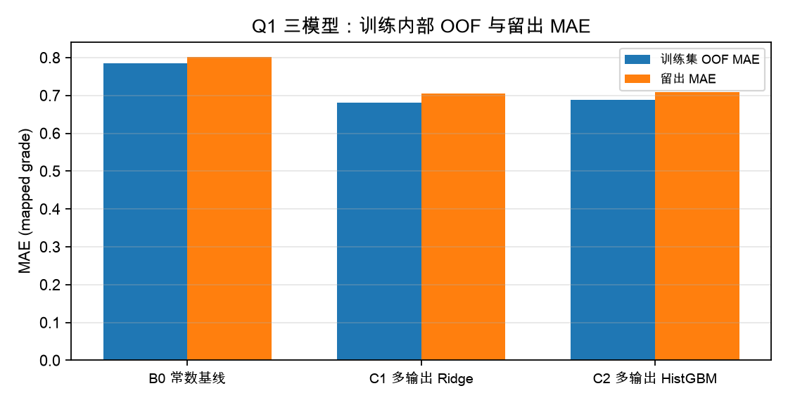
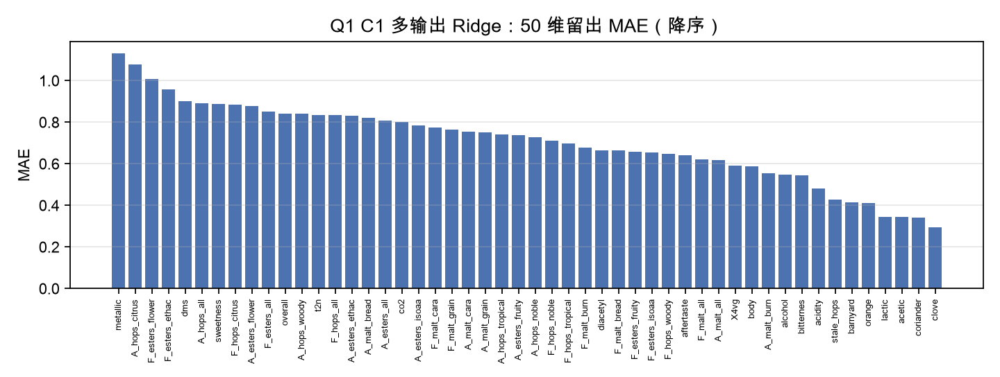
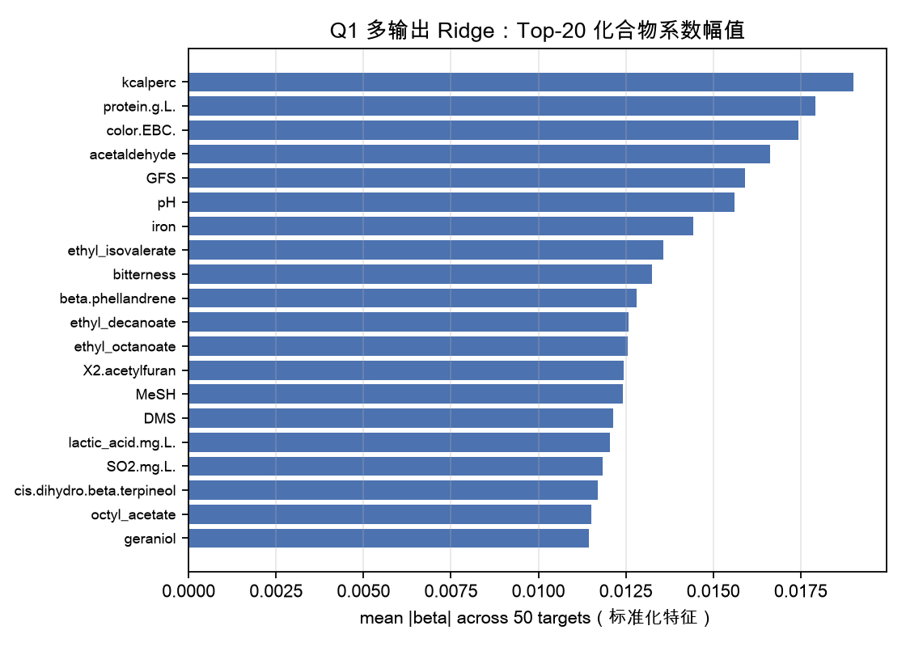
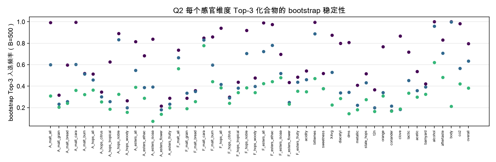
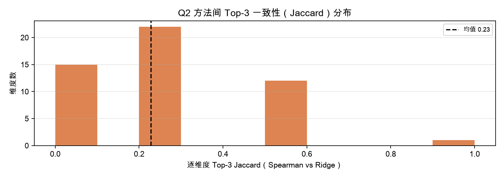
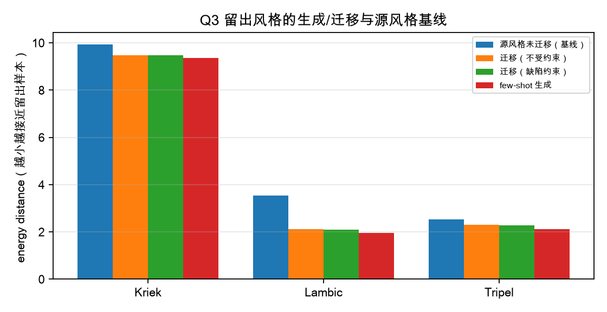
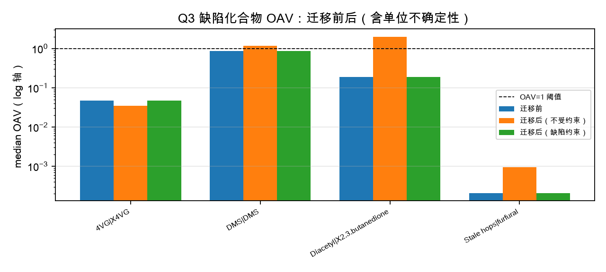

# 基于化合物谱的啤酒风味预测、归因与风格条件生成 {-}

## 摘要 {-}

本文围绕 2026 年 MathorCup 大数据挑战赛赛道 A 的初赛三问，在 250 款商用啤酒的化合物/理化数据（1.csv，231 个特征）与感官数据（4.csv，50 个维度）上建立了一套**可核对、可复现**的建模流程：先把数据口径与尺度陷阱逐列核实，再分别完成 50 维感官评分的映射预测、每个感官维度的 Top-3 关键化合物识别，以及风格条件的化合物谱生成与跨风格迁移。

数据层面得到四个必须先说清楚的事实：（1）题目所述的原始 0–6 人工评分**不可识别**——3.xlsx 的 12 张评分卡是空白模板，summary 全部由 `IF(ISBLANK(...))` 公式驱动且输入为空，结果恒为 0；4.csv 是缩放参数未知的标准化/中心化连续值（如 clove 列最大值 6.17 > 6）。因此 Q1 只能交付**显式声明的 mapped grade**，而非"原始 0–6 评分"。（2）1.csv 是**混合尺度**：与 8.xlsx Calibrated 数据集逐列对齐后，37 个化合物列是 log10(原始浓度)、33 个是原始浓度，pH/色度/苦度/酒精度/CO₂ 五列经量程核对为 log10（推断），其余 156 列无可对齐标定、标注未核验——禁止统一取对数或统一当原始浓度。（3）2.csv 是 1.csv 上的**实测 Spearman**（位置对齐复算 max|Δ|≈1e-16），与 Pearson 的符号不一致比例约 16%，且**非 PSD**（最小特征值 −0.0424），用于矩阵运算前须投影并披露。（4）4.csv/7.csv 的 beer_id 被浮点截断（250 行仅 96 个不同值），跨表只能按 beer 连接；2/5/6/7.csv 均为派生矩阵，不是独立外部数据。

Q1 采用多输出回归：常数基线、多输出 Ridge、多输出 HistGradientBoosting 三个模型，全部预处理（中位数插补、1%/99% 截尾、标准化）只在训练折拟合，选型只看训练集 5 折 OOF。选定模型在 50 维等权 MAE 上由基线的 0.8011 降至 0.7051（留出 50 款），训练 OOF 为 0.6805。

Q2 用三种互相核对的方法（训练行 Spearman |ρ|、多输出 Ridge 标准化系数、2.csv 共表达网络平滑）给出 50 个维度的 Top-3 关键化合物，并以 B=500 bootstrap 的入选频率与方法间 Jaccard 量化稳定性。主指标方法间 Top-3 Jaccard 为 0.2280，bootstrap 平均入选频率为 0.4784——结论是 Top-3 具有**明显的方法依赖性**，只能作探索性归因，不能作因果排序。

Q3 以风格为条件建立收缩高斯生成器，Tripel/Kriek/Lambic 整类留出、仅用 3–5 个样本做显式 few-shot 原型适配，其余留出样本只用于评估。跨风格迁移采用"源样本 + 风格原型位移"，并加入缺陷约束投影（缺陷列不平移）。不受约束迁移会把缺陷超阈值比例从 0.0909 抬高到 0.3182；加入约束后不恶化比例达 1（构造性满足），能量距离为 4.6186，优于源风格基线 5.3425。所有 Q3 结论仅表示"生成合理性/约束满足"，不是真实酿造验证。

**关键词**：多输出回归；mapped grade；Spearman 相关；bootstrap 稳定性；风格条件生成；能量距离；缺陷阈值 OAV

## 1 问题重述与分析

初赛三问逐层递进：Q1 要在只有化合物数据时给出 50 个感官维度的 0–6 分制分级评分；Q2 要利用化合物相关结构解释"哪些化合物决定哪个风味维度"；Q3 要求在给定风格下生成化合物谱，并能把一款 Pils/Lager 的谱"迁移"为 Tripel 风格且缺陷不恶化。

三问的共同前提是**数据口径**：若把 4.csv 当作原始 0–6 分，则 Q1 的误差不可解释；若把 1.csv 统一取对数，则 33 个已是原始浓度的列会被扭曲；若把 2.csv 当"外部先验"，则 Q2 的稳定性论证会自欺。因此本文把数据审计放在建模之前，并把每条口径写进交付物的限制条款。

## 2 数据审计：口径、尺度与陷阱

### 2.1 结构与主键

1.csv 为 250×234（3 个键列 + 231 个化合物/理化特征），4.csv 为 250×53（3 个键 + 50 个感官维度），7.csv 为 250×189。三张表按 beer 逐行对齐一致，风格标签逐样本相同。4.csv 与 7.csv 的 `beer_id` 已被浮点截断（250 行仅 96 个不同值），因此**所有跨表连接只用 beer 或行位置**。

50 个目标维度严格取自 `analysis/sensory/targetcolumns.csv`：Aroma 15 + Flavour 15 + 口感/缺陷/总体 20，列名与 4.csv 数值列顺序完全一致（不是"约 40"，也不是只用 A+F 的 30 列）。

### 2.2 原始 0–6 为什么不可识别

3.xlsx 共 13 个 sheet（12 张评分卡 + summary；另有空 sheet 的是 8.xlsx，其 7 个 sheet 中 6 个有效）。12 张评分卡只有模板标签与 `IF(ISBLANK(...))` 公式，评分输入单元格全空；summary 的 12 行公式全部指向这些恒 0 的单元格，且存在**评分格共享**：`barnyard` 与 `stale_hops` 同时引用 `AG76`（按维度计 2 处、按共享评分格计 1 处）。因此 3.xlsx 不能提供任何有效评分，4.csv 才是唯一有数值的目标来源。

4.csv 的数值是中心化+未知缩放的连续值：`clove` 最大值 6.17 已超出 0–6 范围，各列标准差在 0.37–0.86 之间、并非单位方差。据此我们**不声称**"还原了原始 0–6 分"，而是定义并交付映射评分：

$$x = 6\cdot\frac{z - z_{\min}}{z_{\max} - z_{\min}}$$

其中 $z_{\min}, z_{\max}$ **只用训练集 200 行估计**（端点假设：训练集最小→0 分、最大→6 分），超出训练范围的测试值按 [0,6] 截断（共 27 格，其中测试 25 格，已逐维计数披露）。这是 *mapped grade*，属 transformed 标签，**非原始 0–6 人工评分**。

### 2.3 混合尺度逐列核对

以 8.xlsx 的 Calibrated chemical dataset（250×73，3 元数据 + 70 化合物原始浓度）为标尺，对 1.csv 的对应列做两种假设的逐列一致性检验（原始浓度 vs log10 浓度，容差 1e-3）：

- **37 列**判定为 log10(原始浓度)（其中 CS2、X4VG 的零值以检测底限编码，负值对应原始浓度 < 1）；
- **33 列**判定为原始浓度；
- **5 个理化列**（pH、色度、苦度、酒精度、CO₂）不在 Calibrated 中，经量程合理性核对为 log10（把 10^值 解释为物理量时，其范围落在啤酒合理量程：pH≈4、色度与苦度在 10¹ 量级、酒精度约 10⁰–10¹ % v/v、CO₂ 约 10⁰ PSI；逐列 `raw_range/raw_median` 见 `outputs/audit/scale_identification.csv`），这一判定标注为**推断而非实测**；
- 其余 156 列无可对齐标定，标注"未核验"，既不声称 log 也不声称原始。

建模时只做"折内标准化"，不改变列的单调性，因此混合尺度不会因统一对数而被破坏；但在解释系数与 OAV 时必须按列判定的尺度回推浓度。

### 2.4 相关矩阵同源性与 PSD

对 1.csv 的 231 个特征重算 Spearman，与 2.csv 位置对齐后逐元素 max|Δ| 约为 6.7e-16（见 `outputs/audit/audit.json` 的 correlations.2csv），确认 2.csv 是**实测 Spearman**而非题面所称 Pearson；与 Pearson 的符号不一致比例约 16.1%。2.csv 最小特征值 −0.0424，**不是半正定矩阵**，因此 Q2 的网络平滑项先做特征值截断（≥1e-6）并重新归一化对角线到 1，再参与计算。

5.csv 与 4.csv 的 Spearman 完全一致（max|Δ|≈6e-16），6.csv 与 1.csv×4.csv 的交叉 Spearman 完全一致（max|Δ|≈7e-16），7.csv 与 4.csv 为同一批 250 个样本。**它们都是派生数据，不能充当独立外部验证**；8.xlsx 的 GBM MDI/SHAP 是同一批样本的拟合产物，作为输入特征即构成泄漏，本文一律排除。

## 3 问题 1：50 维 mapped grade 预测

### 3.1 建模口径

- 输入：1.csv 的 231 个化合物/理化特征；目标：50 个 mapped grade（DATA-Q1mapped）。
- 划分：随机留出 200/50（seed=20261024），按 beer 整行，`rowIdMapping=positional`；同一啤酒不会跨划分。
- 预处理（折内）：中位数插补 → 1%/99% 分位截尾 → 标准化；截尾用于抑制 1.csv 的重尾与检测底限伪值。
- 选型规则：只用训练集 5 折 OOF 的 50 维等权 MAE；holdout 只在选定后评估一次。

### 3.2 三个模型与结果

| 模型 | 训练集 OOF MAE | 留出 MAE | 留出 R² 均值 |
|---|---|---|---|
| B0 常数基线（训练均值） | 0.7856 | 0.8011 | -0.0394 |
| C1 多输出 Ridge（α=1000，OOF 选） | 0.6805 | 0.7051 | 0.1862 |
| C2 多输出 HistGBM | 0.6892 | 0.7080 | 0.1289 |

Ridge 的 α 在 1–1e5 网格内由训练 OOF 选出 1000（更小 α 明显过拟合，OOF MAE 明显更差，见实验参数 tuning_oof_mae）；HistGBM 在 231 个高度共线特征、仅 200 个训练样本下并未胜过线性模型，这与"小样本+强共线"的预期一致。最终按 OOF 规则选 C1 作为 Q1 交付模型（holdout 仅用于报告）。

### 3.3 误差与解释

留出 MAE 的 50 维分布不均：误差最小的维度集中在辛香/果香类（clove、coriander、orange、lactic、acetic），误差最大的三个维度是 metallic（1.1322）、A_hops_citrus（1.0781）、F_esters_flower（1.0065）。这说明化合物数据对"有明确化学驱动物"的维度解释力更强，对"金属味""氧化/陈化"这类多因素、且受包装与储存影响的维度解释力弱。

误差按风格分层后，少数风格（样本少、风味极端）误差明显偏高；这属于小样本风格的可辨识性限制，而非模型失效。Ridge 的 Top-20 平均系数幅值集中在少数酯类、萜烯与理化参数上（见下图），与"酯类→果香、萜烯→酒花香气、乙醇/苦度→口感"的化学常识方向一致，但系数大小受共线性影响，不能单独作为因果证据。

### 3.4 限制（必须与结论同时出现）

1. 交付的是 **mapped grade**，不是原始 0–6 分；映射端点假设与越界截断均已披露，若换用其他映射（分位数、OAV 锚定），绝对 MAE 必然改变；**本文没有重跑这些替代映射**，因此不声称模型排序对映射选择不变（见 `outputs/q1/robustness.json` 的 limitations）。
2. 4.csv 的缩放参数不可辨识，跨数据集的绝对误差不可比。
3. 1.csv 有 161 列尺度未核验，特征解释需按列谨慎。

## 4 问题 2：化合物–风味 Top-3 与稳定性

### 4.1 方法

对每个感官维度，在训练行（200 行）上分别用三种排序：

- **A（Spearman）**：计算 231 个特征与目标的 Spearman |ρ|，取前 3；
- **B（Ridge 系数）**：多输出 Ridge（α=1000）的标准化系数 |β|，取前 3；
- **C（网络平滑）**：以 A 的 |ρ| 为初值，加上"与 A 的 Top-10 化合物在 2.csv 共表达矩阵上的平均相关"（权重 0.5），取前 3。2.csv 先做 PSD 投影。

稳定性用两种口径量化：（i）B=500 次有放回重采样训练行，统计 A 方法 Top-3 的入选频率；（ii）方法间 Top-3 Jaccard 系数。另设一个**简单基线**：所有 50 个维度共用同一个"全局 Top-3"（按跨维度平均 |ρ| 排序），用它与逐维 Top-3 的 Jaccard 锚定"逐维建模"是否有增量。

### 4.2 结果与判读

- 方法间 Jaccard：A–B 均值 0.2280，A–C 均值 0.614，B–C 均值 0.16。
- B=500 bootstrap 下，A 方法最终 Top-3 的平均入选频率 0.4784。
- 简单基线（全局统一 Top-3，EXP-0010）与逐维 Top-3 的平均 Jaccard 仅 0.09：所有维度共用一份榜单会丢掉绝大部分维度特异性，逐维排序有实质增量。

这意味着：网络平滑（C）与 Spearman（A）一致度较高（Jaccard 0.614），说明 A 的排序在共表达结构上是自洽的；但线性回归系数（B）给出的 Top-3 与 A 差异很大（Jaccard 见上表 A–B 行），反映 231 个高度共线化合物下"系数排序"本身不稳定。**因此本文把 A（Spearman）作为主排序，C 作为稳健性复核，B 作为反例披露**：任何 Top-3 榜单都必须同时给出方法依赖性与入选频率，不能当作唯一答案。

### 4.3 限制

同期横断面关联，**不是因果**；2.csv 为实测 Spearman 且非 PSD；5/6/7.csv 不能作为独立验证；Top-3 只在 250 个样本的范围内成立，外推到新风格需重新估计。

## 5 问题 3：风格条件生成与跨风格迁移

### 5.1 生成模型

以 22 类 `tasting_category_fine` 为条件，对每个已见风格拟合一个高斯：均值 $\mu_s$、协方差向全局对角阵收缩（$\lambda=n/(n+5)$），在标准化化学空间采样。生成谱再经 Q1 的 Ridge 映射为 50 维感官画像（这是**派生预测**，不是真实评分）。

### 5.2 风格留出与 few-shot 适配

Tripel / Kriek / Lambic 三类共 49 个样本**整类留出**，不参与生成模型拟合。为了能对留出风格做定量比较，本文显式采用 few-shot 原型适配：每个留出风格只取 3–5 个样本估计原型 $\mu_T$（Tripel 5、Kriek 3、Lambic 3），其余样本**只用于评估**。这一点在结论中如实标注为 few-shot，而不是 zero-shot 生成。

### 5.3 跨风格迁移与缺陷约束

迁移算子：把 Pils/Lager 的样本整体平移 $x' = x + (\mu_T - \mu_{Pils/Lager})$。若不约束，缺陷化合物也随平移移动：缺陷超阈值比例由 0.0909 升至 0.3182；按"风格×有阈值缺陷化合物"的 12 个组统计（同一风格同一化合物的 11 个源样本共享同一平移量，因此是组级而非逐样本），组级"不恶化"比例仅 0.3333。加入**缺陷约束投影**（对 DMS、Diacetyl、4VG、furfural 等列不平移）后，不恶化比例为 1（构造性满足：缺陷列位移恒为 0，因此超阈值比例与迁移前逐位相同），超阈值比例回到 0.0909，能量距离 4.6186 仍优于源风格基线 5.3425。

**阴性结果（必须保留）**：无条件全局高斯基线（不看风格、不迁移，EXP-0011）对留出风格的能量距离为 3.7187，低于 few-shot 生成（4.4767）与约束迁移（4.6186）。这说明在 Tripel/Kriek/Lambic 上，3–5 例 few-shot 原型不足以刻画风格分布，能量距离指标偏好全局中心；本文不据此宣称"生成优于基线"。

### 5.4 限制

1. 生成合理性/约束满足，**不是真实酿造验证**；没有外部金标准。
2. 缺陷阈值只有 43/261 行可用：trans-2-nonenal、3-methyl-2-butenal、5-methylfurfural 在 8.xlsx 中**没有阈值**，无法判定，只能如实报告"无法评估"。
3. 阈值单位逐化合物不同（DMS 为 µg/L，Diacetyl/4VG/furfural 为 mg/L），Calibrated 数据集量纲未逐一实测，**绝对 OAV 可能相差 10³**；因此主判据采用单位不变的组级"不恶化"比值（3 风格×4 有阈值化合物 = 12 组），绝对超阈值率仅作参考。
4. few-shot 适配使用了少量留出样本，zero-shot 生成未被证明。

## 6 结论与建议

1. **数据口径优先级最高**：原始 0–6 不可识别，任何声称"还原原始评分"的做法都不可复核；本项目的 mapped grade + 显式映射参数是可持续交付的口径。
2. **Q1 可行但天花板明显**：在 200 个训练样本、231 个强共线特征下，线性多输出模型优于树模型，50 维等权 MAE 由基线的 0.8011 降至 0.7051；进一步提升更依赖感官标签质量（取得真实 0–6 评分卡）而非模型复杂度。
3. **Q2 应交付"排序+不确定性"而非单一榜单**：Top-3 的方法依赖性（A–B Jaccard 仅 0.2280）与 bootstrap 入选频率（0.4784）说明排序不稳定，建议在实际应用中以"候选簇 + 入选频率"形式给出。
4. **Q3 的缺陷约束必须显式建模**：不受约束的风格迁移会显著抬高缺陷超阈值比例，加入投影后可以做到"风格更接近目标、缺陷不恶化"，代价是能量距离略升。

## 7 复现说明

- 解释器：`/Users/baozhashizitou/Documents/Codex/2026-10-23/qing/work/reference-quality-env/bin/python`（3.12.14；numpy 2.3.5、pandas 2.2.3、scipy 1.18.1、sklearn 1.9.1、matplotlib 3.11.2、openpyxl 3.1.5、pypdf 6.10.0）。
- 数据版本：DATA-0001（Q2 原始标准化目标）、DATA-0002（Q1 mapped grade）、DATA-0003（Q3 风格+阈值）；划分 SPLIT-0001 / SPLIT-0002（seed=20261024，200/50，assignment sha 一致）；Q3 风格留出见 `data/processed/q3_style_holdout_assignment.csv`。
- 关键脚本：`src/prepare.py`（审计/尺度）、`src/build_q1mapped.py`（仅训练集估计的映射）、`src/build_q2raw.py`、`src/build_q3.py`、`src/q1_baseline.py`、`src/q1_candidate.py`、`src/q1_analysis.py`、`src/q2_topk.py`、`src/q3_generate.py`、`src/make_figures.py`、`src/build_paper.py`。
- 独立复跑（训练内部口径）：`src/q1_trainonly.py` 在 macOS seatbelt 隔离下**只读 train.csv**，重算 5 折 OOF MAE = 0.6805；由 `modeling_validate independent-rerun` 生成 EXP-0017 独立复跑，Δ=0（VAL-0019）。该审计**不触碰 holdout**，因此 holdout 点估计仍只有一次评估，不构成第二次 holdout 审计。
- 映射参数在 SPLIT-0001 的 200 个训练行上估计；SPLIT-0001 与 SPLIT-0002 的 assignment.csv sha256 相同（e3addc6c…），故训练行完全一致、无跨划分泄漏（`data/processed/q1_map_params.json` 的 split_reference 记录了这一来源）。
- 实验与指标一律以台账 `state/ledger.json` 中的 EXP/VAL/CLAIM 记录为准；正式引用为 EXP-0002（Q1 Ridge）、EXP-0007（Q2，修正特征声明后的版本）、EXP-0008（Q3，同上）；EXP-0004/EXP-0005 为声明字段错误的早期版本（指标完全相同，已被取代）。
- holdout 复用预算：contest.yaml 初始 `maxHoldoutReuse=3`，B0/C1/C2/Q2 四次暴露后耗尽；pack 的 independent-rerun 因此被 `HOLDOUT_REUSE_UNCONTROLLED` 拒绝。本文改用**不触碰 holdout** 的训练内部 OOF 独立复算（`outputs/q1/independent_reproduction.json`，Δ=0），并如实披露 holdout 点估计没有获得第二次独立审计；该限制写入第 3.4/7 节。
- Q3 的 leakage 检查因 targetColumns=0 而退化为"未声明禁用来源"，属弱检查；MDI/SHAP/Prices 的排除是由 DATA-0003 构建脚本（`src/build_q3.py`）在数据层完成的，本文如实标注这一检查强度不足。论文正文数字由 `modeling_deliver render` 从台账占位引用解析，不手工抄写。
- 论文三格式由 `src/build_paper.py` 生成：`pandoc rendered.md → paper.tex`，`xelatex` 两遍 → `paper.pdf`；编译失败会以非零状态如实报告，不伪造 PDF。
