<!--
定稿说明（本注释在最终交付前删除）：
· 数据事实可追溯到 report/data-quality.md（唯一数据侧依据）与题面 Markdown；实验数值全部使用台账占位符。
· 主线实验：EXP-0001..0003（Q1 基线/岭回归/HGB）、EXP-0004/0005（Q2 基线/逐维）、EXP-0006/0007（Q3 基线/条件生成）。
· 图已登记：FIG-0001..FIG-0012，正文 12 处引用，无遗漏。CLAIM-0001..0004 已解析（含负结果 CLAIM-0004）。
· 稳健性：ROB-0002/ROB-0005 通过、ROB-0004（Q1）失败并保留负结果；ROB-0001/ROB-0003 未执行（嵌套参数不可证实），由 ROB-0004/0005 同规则替代。
· 独立复跑：Q2/Q3 成功（EXP-0019/EXP-0021，VAL-0011/0012 passed）；Q1 未完成（EXP-0012 失败 + idempotency 卡住），交付只能是 DRAFT。
-->

## 摘要

本文研究商用啤酒风味代谢数据集中三个相互衔接的问题：在只有化合物/理化检测量的条件下给出 50 个感官维度的分级评分；在每个感官维度上给出 Top-3 关键化合物并量化其稳定性；以及以风格为条件生成合理的化合物谱并完成跨风格迁移。数据本身存在四类真实缺陷，构成本文全部方法的出发点：231 个化学/理化列混合了 log10 变换、零值底限编码与原始浓度三种尺度；4.csv 的感官列是标准化连续值而非题面所述的原始 0–6 评分；2/5/6/7 号附件与 1/4 号附件同源派生，不能充当独立外部验证；3.xlsx 的 12 张评分卡是空白模板。因此本文首先把“可识别性”写进模型契约，再谈精度。

问题一采用**映射分级（mapped grade，非原始 0–6）**作为交付目标：以显式线性映射 $x = 6\,(z-z_{\min})/(z_{\max}-z_{\min})$ 把 4.csv 的标准化值映射到 0–6 名义区间，映射参数只用 200 个训练行估计、不裁剪越界值。建模上先跑“逐目标训练中位数”常数基线，再比较岭回归与直方图梯度提升两个候选族；模型选择只用训练内部 5 折 OOF，留出集仅在最终锁定时使用一次，评价指标为 50 个目标留出 MAE 的均匀平均。留出集上，基线 MAE 为 0.7509114931486188，选中的岭回归为 0.6685467308887166。

问题二以 2.csv 的 Spearman 共表达结构为背景（该矩阵非半正定，最小特征值约为 −0.0424，故先做特征值裁剪 PSD 投影并记录投影前后谱），用三种互异排序（|Spearman ρ|、多输出岭回归系数绝对值、随机森林不纯度重要度）给出每个感官维度的 Top-3，并用 500 次训练行内 bootstrap 重采样统计入选频率、以方法间 Jaccard 系数度量稳定性。逐维方法间 Top-3 Jaccard 均值为 0.22466666666666665，bootstrap 平均入选频率为 0.4615666666666666。全部结论限定为**同期关联**，不作因果解释。

问题三把风格 `tasting_category_fine` 作为条件标签（Tripel/Kriek/Lambic 三个风格整体留出，共 49 行），在 7 个有真实数值阈值的缺陷化合物上定义“原始浓度/阈值 − 1 ≤ 0”的硬约束，并报告约束满足率、能量距离、感官画像一致性与迁移前后缺陷不恶化率。风格条件生成在**带约束投影**下满足率为 1，而同一生成器**不做投影**时仅 0.04——前者是硬投影的构造性结果，不是分布拟合的胜利；投影几乎不改变分布距离（能量距离由 3.486382987639628 变为 3.501495913841147），因此"满足率高"完全来自后处理，而不是生成器学会了避缺陷。作为参照，250 个真实啤酒样本中同时满足全部 7 项约束的只有 6 个（0.024），留出风格 Tripel/Kriek/Lambic 的 49 个真实样本中满足全部 7 项的比例为 0。`trans-2-nonenal` 与 `Stale hops` 在附件中无数值阈值，其缺陷约束**不可评估**，本文不编造阈值。

本文的适用边界是明确的：交付的是 mapped grade 而非原始 0–6 评分；Q2 是同期关联而非因果；Q3 是生成合理性与约束满足，不是真实酿造验证。比赛页数、字数、命名与匿名要求未在 `contest.yaml` 的 `delivery.contest` 中声明，本文记 `skip`，不编造任何官方要求。

**关键词**：多输出回归；映射分级（mapped grade）；Spearman 共表达；bootstrap 稳定性；风格条件生成；阈值约束满足

---

## 一、问题分析

### 1.1 三个任务及其交付物

题面（`problem/2026年MathorCup大数据挑战赛-赛道A初赛.md`）给出三个递进任务：给评分、找关键化合物、按风格生成。三问共享同一批 250 个啤酒样本，但输入、输出与评价方式不同，必须分别建立数据版本与划分，不能互相复用留出集。

| 小问 | 题面要求（原文要点） | 输入 | 必须给出的结果 | 本文评价方式 |
|---|---|---|---|---|
| 问题一 | “以 1.csv 化合物数据为基础，给出 3.xlsx 中定义的 Aroma 与 Flavour 两套、共约 40 个感官维度的 0–6 分制的分级评分结果” | `q1_mapped.csv`（`data/processed/`）的 231 个 `chem__*` 特征；50 个 mapped grade 目标 | 50 维连续分级评分、逐目标误差、误差诊断图 | 多输出 MAE（50 个目标留出 MAE 均匀平均），指标键 `mae` |
| 问题二 | “利用 2.csv 的化合物相关数据构建化合物共表达图，结合 1.csv 特征，给出每个感官维度的 Top-3 关键因素化合物，并进行稳定性与化学合理性论证” | `q2_raw.csv`（`data/processed/`）的 231 个特征 + 50 个标准化感官列（仅训练行） | 每个维度 × 每种方法的 Top-3、bootstrap 入选频率、方法间 Jaccard、共表达结构图 | 逐维方法间 Top-3 Jaccard 均值，指标键 `topk-jaccard` |
| 问题三 | “以 tasting_category_fine 为风格标签，学习风格条件生成模型……给出其感官画像；同时做跨风格迁移……保持缺陷化合物不恶化” | `q3_table.csv`（`data/processed/`）的 231 个特征 + `style`/`style_holdout` + 43 个 `thr__*` 阈值常数列 | 各风格条件化合物谱、感官画像、跨风格迁移结果、逐项缺陷前后对比 | 7 项缺陷约束的约束满足率，指标键 `constraint-satisfaction` |

### 1.2 为什么这样建模：数据现实先于模型选择

三个关键判断决定了建模路线，全部有实测依据（详见第二节）：

1. **题面说“约 40 个维度”，实际目标是 50 个。** `problem/targetcolumns.csv` 给出 50 个真实目标列，且与 3.xlsx `summary` 的 50 个目标列一一对应；其中 Aroma 15 个、Flavour 15 个、口感/缺陷/总体 20 个。本文以 50 列为准，并在 2.1 节说明差异来源。把“约 40”当真、只取 `A_*+F_*` 的 30 列会漏掉缺陷与总体维度，直接违背题面“Aroma 与 Flavour 两套”之外的口味/缺陷/总体要求。
2. **题面说 4.csv 是“标准化/中心化的连续值，不是原始 0–6”，这一点数据支持。** 但 3.xlsx 的 12 张评分卡是空白模板、`summary` 求值后全为 0 且只覆盖 12 款酒、4.csv 的标准化参数附件中没有任何记录，因此原始 0–6 分**不可还原**。任何声称“还原原始评分”的做法都是不可核对的。本文只能交付显式映射的 mapped grade，并把映射公式、端点处理与 15 个越界单元格逐格登记。
3. **题面暗示可以把相关矩阵当外部信息，实际不是。** 2.csv 经重算是 1.csv 的 Spearman 相关矩阵（不是题面所称的皮尔逊），且非半正定；5/6/7.csv 与 1/4.csv 同源派生。把它们当独立先验或外部验证会系统性高估证据强度。本文只把 2.csv 当**结构参考**，5/6/7 不作任何验证。

### 1.3 三问的建模策略与技术路线

- **问题一**：这是一个“输入可得、标签不可直接观测”的多输出监督问题。决策时点是“化合物检测完成、感官评分尚未获得”，因此输入只能是 1.csv 的 231 列；50 个感官列是目标，绝不作特征。模型族上按“常数族 → 线性族 → 非线性族”递进，目的不是追求最复杂模型，而是检验“化合物谱对感官 grade 是否含有可用信号”这一可证伪问题：若两个候选在 train-only OOF 上都不优于常数基线，则如实报告负结果。
- **问题二**：这是描述性关联分析，不是预测。排序只在训练行内做，评价的是“不同方法给出的 Top-3 是否一致、bootstrap 下是否稳定”，而不是对外部标签的精度。Jaccard 系数之所以合适，是因为它直接度量集合稳定性且与 pack 的 set-stability 复算定义一致（逐维方法两两 Jaccard 的均值再对 50 维取均值）。
- **问题三**：这是条件生成 + 约束满足问题。风格是条件标签而不是待预测标签；评价必须落在“生成谱是否接近该风格训练分布”与“是否满足缺陷阈值约束”两件事上。缺陷阈值只能取 8.xlsx 中真有数值的 7 个化合物；没有阈值的两个题面点名项只能写进限制。

### 1.4 符号与记号约定

| 记号 | 含义 | 取值/单位 |
|---|---|---|
| `X` | 1.csv 化学/理化矩阵，231 列（`chem__*`） | 混合尺度，逐列见第二节 |
| `Y` | 4.csv 的 50 个感官列 | 标准化/中心化连续值（非原始 0–6） |
| `z_{i,t}` | 第 `i` 行第 `t` 个感官列在 4.csv 中的原值 | 标准化值 |
| `zmin_t, zmax_t` | 第 `t` 个目标在 200 个训练行上的最小/最大值 | 训练行估计 |
| `g_t(z)` | mapped grade 映射 `6·(z−zmin_t)/(zmax_t−zmin_t)` | 名义 [0,6] |
| `ŷ_{i,t}` | 第 `i` 行第 `t` 个目标的预测 mapped grade | mapped grade 单位 |
| `MAE` | 50 个目标留出 MAE 的算术平均（uniform-average） | mapped grade 单位 |
| `ρ` | Spearman 秩相关系数 | [−1,1] |
| `J(A,B)` | 两个 Top-3 集合的 Jaccard：`|A∩B|/|A∪B|`，`k=3` 时等于 `交集/(6−交集)` | [0,1] |
| `e_c` | 缺陷化合物 `c` 的超出量 `原始浓度/阈值 − 1` | 无量纲 |
| `c_sat` | 约束满足率：同时满足全部缺陷约束的样本比例 | [0,1] |

### 1.5 方法纪律

1. **先协议、后比较**：验证计划在任何候选比较之前登记；holdout 只用于最终比较，选模只用训练内部交叉验证/自助法。
2. **留出集预算**：`contest.yaml` 规定同类留出最多复用 3 次；问题一为“基线 1 次 + 候选 2 次”，问题二/三各用独立数据版本与划分。
3. **数字可追溯**：正文所有实验数值由台账占位符渲染，不手抄；数据事实一律标注到 `report/data-quality.md` 的具体节。
4. **失败如实报告**：实验状态为 failed/timed-out/interrupted、检查未通过或结论过期，均按原样记录并说明对结论的影响，不用静默重跑掩盖。

---

## 二、数据质量与尺度核对

本节是全文的数据侧依据。所有数字均由 `src/00_prepare_q1q2.py`、`src/00_prepare_q3.py` 实际计算并写入 `data/processed/data_quality.json` 与 `data/processed/q3_thresholds.json`，完整论证见 `report/data-quality.md`（12 节）。本节只摘录与建模直接相关的结论，并给出可复算的核对方式。

### 2.1 附件构成、数据版本与划分

| 附件 | 台账 role | 实际形状 | 本文用途 |
|---|---|---|---|
| 1.csv | chemical_features | 250 × 234（`beer`、`beer_id`、`tasting_category_fine` + 231 个化合物/理化列） | Q1/Q2 输入特征；Q3 化合物域 |
| 2.csv | compound_correlation | 231 × 232（矩阵 231×231） | Q2 共表达结构参考（非独立先验） |
| 3.xlsx | sensory_scorecards | 13 sheet（`beer_1`…`beer_12` + `summary`） | 仅用于说明 50 个目标列的语义/量表 |
| 4.csv | sensory_targets | 250 × 53（3 元数据 + 50 个标准化感官列） | Q1 mapped grade 的唯一标签来源；Q2 关联目标 |
| 5.csv | sensory_correlation | 50 × 50 | 描述性参考，不作验证 |
| 6.csv | chemical_sensory_correlation | 实际 44 × 50（题面写 46 × 50） | 描述性参考，不作验证 |
| 7.csv | sensory_descriptors | 250 × 189 | 描述性参考，不作输入、不作验证 |
| 8.xlsx | reference_thresholds | 7 个 sheet（6 个有效 + 空 Sheet2：thresholds 261×11、names 101×8、MDI 231×2、SHAP 500×235、Calibrated 250×73、Prices 250×11） | 阈值与名称映射；其余见 2.8 |
| 数据说明.txt | data_notes | 614 字节 | 仅作说明，不替代题面 |

由清洗脚本产出的三个**互不混用**的数据版本：

| 版本 id | 文件 | 形状 | 用途 |
|---|---|---|---|
| DATA-0001 | `data/processed/q1_mapped.csv` | 250 × 285（4 元数据 + 231 `chem__*` + 50 mapped grade） | Q1 |
| DATA-0002 | `data/processed/q2_raw.csv` | 250 × 285（4 元数据 + 231 `chem__*` + 50 原始标准化感官列） | Q2 |
| DATA-0003 | `data/processed/q3_table.csv` | 250 × 279（5 个元数据列 + 231 `chem__*` + 43 `thr__*`；元数据列为 `row`/`beer`/`beer_id`/`style`/`style_holdout`） | Q3 |

划分均为 `random-holdout`、`testFraction=0.2`、`seed=20261024`、按 `beer` 一行、`rowIdMapping="positional"`，训练 200 行 / 测试 50 行；三个划分的 `assignment.csv` 内容相同（同一批 250 行、同一 seed），但分别登记为 SPLIT-0001/0002/0003，**不跨小问复用留出集**。问题三的跨风格预算另由 `style_holdout` 列承担（见 5.2），随机划分只服务于无条件基线。

### 2.2 行对齐与主键：只能用行位置，不能用 `beer_id`

- 1.csv、4.csv 与 8.xlsx “Calibrated chemical dataset” 的 `beer` 列**逐行完全相同**（同一置换）；1.csv 与 4.csv 的 `tasting_category_fine` **100% 相同**（22 个风格）。
- `beer` 是 1..250 的一个置换，不是行号（第 0 行 `beer=10`，第 1 行 `beer=86`）。因此本项目的划分与所有合并都用 **0 基行位置 `row`**（等价合法键是 `beer`）。
- **`beer_id` 被数值截断**：1.csv 有 250 个不同 `beer_id`，4.csv 只剩 **96 个不同值**（例如 `5413970150111` 变成 `5413970000000.0`），且一个 4.csv `beer_id` 最多对应 **20 款**不同的酒；7.csv 同样是 96 个不同值。因此 `beer_id` **绝不能**作为连接键。

### 2.3 混合尺度：231 列逐列判决，禁止统一取对数或统一当原始浓度

| 类别 | 列数 | 判定依据 |
|---|---|---|
| log10 变换 | 196 | 原始浓度不可能为负；其中 35 列与 8.xlsx Calibrated 的原始浓度满足 `1.csv 值 ≡ log10(原始浓度)`（中位误差 ≤ 5e-10） |
| 零值底限编码的 log10 | 2（`CS2`、`X4VG`） | 对应原始值在 ≥50% 样本上恰为 0（CS2 209/250、X4VG 168/250），1.csv 用一个恒定底限代替（CS2 = −2.146292、X4VG = −2.013157），该值不代表浓度 |
| 原始浓度 | 33 | 与 Calibrated 原始浓度逐位相等（中位误差 < 1e-6） |
| 合计 | 231 | 196 + 2 + 33 |

判定方法可复算：对 70 个同时出现在 Calibrated 的列，分别按“1.csv 是原始浓度”与“1.csv 是 log10(原始浓度)”两种假设计算中位绝对误差，取误差更小者；其余 161 列用“负值 → 必然经过对数变换”以及同族列一致性判定，并在 `perColumnCheck[*].confidence` 标注置信度——其中 **145 列由负值直接证明（high）**、**16 列无负值、判定为 medium**。70 个可对齐列的分布是 35 个 log10 + 2 个零值底限 + 33 个原始浓度。**这 16 个 medium 列是本文尺度判决中最不确定的部分**，第三/五节涉及这些列时应按“log10 空间”使用，但不能宣称绝对证明。

### 2.4 题面与数据的矛盾：题面称“保留原始量纲”的理化列实测仍是 log10

题面说“少量理化参数列（如 ethanol、color、bitterness、pH、CO2）保留原始量纲”，并要求参赛者自行核实变换底数。实测证据否证了这句话：

| 列 | 1.csv 实测范围 | 等于 `log10` 的 Calibrated 原始值范围 | 单位（阈值表） | 结论 |
|---|---|---|---|---|
| `pH` | 0.5705 – 0.6744 | 3.72 – 4.73 | — | `1.csv = log10(原始)`，误差 < 1e-9 |
| `color.EBC.` | 0.6532 – 2.4762 | 4.50 – 299.35 | EBC | 同上 |
| `bitterness` | −1.1442 – 1.7941 | 0 – 62.25 | IBU | 同上 |
| `ethanol..v.v.` | −1.4559 – 1.0660 | 0 – 11.64 | %v/v | 同上（0 值按 0 处理） |
| `CO2.PSI.` | −0.2310 – 0.7076 | 1.175 – 5.10 | PSI | 同上 |

五列都满足 `1.csv 值 = log10(Calibrated 原始值)`（pH 的 0.6139 = log10(4.11)，正是酒类 pH 的常识范围）。**结论：以数据为准，题面这句话在附件中不成立；本文在第三/五节一律按 log10 空间使用这些列，并在需要原始单位时逐列取 `10^x` 反变换。** 另有 4 个派生汇总列（`esters_sum`、`aroma_hops_sum`、`acids_sum`、`sulfur_sum`）落在对数空间（`kcalperc` 已精确验证为 log10(千卡)），它们是“由多个化合物计算得出”的派生量，不是独立测量。

### 2.5 缺失值与填补规则

- 1.csv 仅有 **9 列 73 个缺失单元格**：`amyl.acetate` 27、`aroma_hops_sum` 13、`methylpyrazine` 12、`X2.3.butanedione` 9、`X3.methylbutanal` 7、`ethyl.nicotinate` 2、`ethyl.isobutyrate` 1、`furfural` 1、`phenylacetaldehyde` 1。
- 填补规则：对每一列用 **seed 20261024 划分出的 200 个训练行**的中位数填补；测试行从不参与计算填补值（测试行中位数仅作诊断记录）。中位数先算、再填补，因此净化后的值不会进入 `zmin/zmax` 估计。
- **4.csv 完全无缺失**，所以 Q1/Q2 的 50 个目标列在任何情况下都不会被填补，也不存在用测试目标统计量的问题。
- 保真性（脚本内断言）：57677 个非缺失 `chem__` 单元格写出 CSV 再读回逐位相同；无单元格被写成 NaN；Q2 目标块与 4.csv 逐位相同。

### 2.6 派生相关矩阵：2/5/6/7 与 1/4 同源，不能当外部验证

| 文件 | 实际形状 | 内容 | 实测证据 |
|---|---|---|---|
| 2.csv | 231 × 231 | 化学-化学相关 | **是 Spearman，不是 Pearson**：用 1.csv 重算 Spearman，与 2.csv 的 26565 个配对 **max\|Δ\| = 6.66e-16**；与 Pearson 相比 **16.94%** 的单元格符号相反。**非 PSD**：最小特征值 **−0.0424**（最大 33.45） |
| 5.csv | 50 × 50 | 感官-感官相关 | 对角元全为 1，标签是感官名（需经 8.xlsx “Sensory names” 映射） |
| 6.csv | **44 × 50** | 化学 × 感官交叉相关 | 44 行化学物（可 44/44 解析回 1.csv 列）、50 列感官属性（49/50 与 8.xlsx `CleanName_Paper` 精确匹配，剩 1 个是含换行的 `Overall appreciation`，仍是同一维度）。**题面说 46×50，实际 44×50（差 2 行）——以实测为准** |
| 7.csv | 250 × 189 | 250 个样本的感官描述符 | 62 个 `aroma_*` + 62 个 `palate_*` + 62 个 `taste_*` + 3 列元数据；其中 `palate_acetaldehyde`、`palate_acetate`、`palate_dentist` 三列 **250 行全为 NA**；`beer` 顺序与 1.csv 完全一致 |

2.csv 的 231 个标签可用 8.xlsx “Sensory thresholds” 的 `chemical_name → field_name_R` 映射**全部 231/231** 解析回 1.csv 列名。5/6/7 都是**同一批 250 个样本**的派生结果：它们可以提供“结构一致性”的描述性证据，但**不能作为独立外部验证集**，也不能当作与 1.csv/4.csv 相互独立的先验。数据说明.txt 把 7.csv 说成“论坛评论数据”，实际它是同批 250 样本的标准化感官描述符（与 4.csv 同一批样本、`beer` 顺序一致）——**说明文字与内容不符，以实测为准**。

### 2.7 3.xlsx：12 张空白评分卡 + `summary` 全 0 + 公式误引

- 13 个 sheet：`beer_1 … beer_12`（12 张人工评分卡）+ `summary`。
- **12 张评分卡都是空白模板**：卡片里唯一的非零数字是 0–6 评分刻度的列标题（芳香列 E/G/I/K/M/O = 1/2/3/4/5/6，风味列 U/W/Y/AA/AC/AE = 1/2/3/4/5/6）和少量 0/1 勾选标记；真正的评分列 **Q 列与 AG 列在所有 12 张卡上全为 0**（评分格子为空，公式 `=IF(ISBLANK(...),0,...)` 求值为 0）。
- `summary`：52 列（`Beer` + 50 个目标列 + `comments`）、13 行（表头 + Beer# 1..12），每格是 `=beer_1!$Q$7` 这类**跨表引用**，`data_only` 求值后数值单元格**全部为 0**；且 `summary` 只覆盖 **12 款酒**，而 4.csv 有 250 个样本。
- **公式误引（已实测确认）**：50 个目标引用 50 个卡片单元格，其中 `stale_hops` 与 `barnyard` **共用同一个单元格** `beer_x!AG76`，而该单元格在卡片上的标签是 “Stale hops (cheesy, roquefort)”，即 **`barnyard` 被错误地指向了 stale hops 的评分位**（其余 48 个引用与卡片标签一一对应）。
- 结论：3.xlsx 既不能作为 Q1 的标签来源（空白），也不能作为校验集（全 0，且只覆盖 12 款酒）。**以 4.csv 为权威标签**；3.xlsx 仅用于说明“50 个目标列的语义/量表定义”（`problem/targetcolumns.csv` 已把目标列 ↔ 卡片属性 ↔ `summary` 单元格的对应关系固化）。原始 3.xlsx 未被修改，上述差异只记录在数据质量报告。

### 2.8 8.xlsx：只有“阈值”和“名称”可用，其余要么禁用要么只作核对

| sheet | 实际形状 | 本文如何使用 |
|---|---|---|
| Sensory thresholds | 261 行 × 11 列 | **唯一阈值来源**：43 行有数值阈值（`threshold_mean`/`threshold_median` 各 43 个非空）、7 行有 `off_flavors` 标记 |
| Sensory names | 101 行 × 8 列（50 Trained + 51 Ratebeer） | 仅用于把 5/6.csv 的感官列名映射到 4.csv 目标列 |
| GBM importance MDI | 231 行 × 2 列 | **禁止作输入特征**：它是在这同一批 250 个样本上拟合出的模型输出，当作特征即目标泄漏 |
| GBM SHAP Values | 500 行 × 235 列 | **禁止作输入特征**：同上，是同一批样本的 SHAP 分解结果 |
| Calibrated chemical dataset | 250 行 × 73 列（3 元数据 + 70 化合物原始浓度） | **只用于核对尺度**（2.3–2.4 节的 70 列判定）；不作特征、不作填补来源、不作划分来源 |
| Beer Prices | 250 行 × 11 列 | **不作核心输入**：7 个价格列缺失严重（`Price_BeerHawk_UK` 204/250 缺失、`Price_Colruyt_Belgium` 170、`Price_TotalWine_USA` 164、`Price_Delhaize_Belgium` 159、`Price_TheBelgianBeerShop_global` 156、`Price_BeerOfBelgium_global` 109、`Price_TheBelgianShop_global` 43），21 款酒 7 个价格全缺；价格也不能解释化合物谱 |
| Sheet2 | 空表 | 忽略 |

Calibrated 与 1.csv 的一致性核对（只作核对记录，不影响尺度判决）：73 个单元格差 > 1e-3、分布在 30 个列上，最集中的是 `row 105 / beer 177`（`n.hexanol`、`Z.nerolidol`、`X3Z.hexenol` 三个化合物不一致），另有若干单元格在两侧互为 NaN；Calibrated 自身还有两列出现负的“原始浓度”（`betaglucan.mg.L.` min −2.0、`unfermentables` min −16.755），进一步说明它不能当原始浓度真值使用。

### 2.9 问题一目标的可识别性：mapped grade，非原始 0–6

**公式**：$x = 6\,(z-z_{\min})/(z_{\max}-z_{\min})$，其中 `z` 为 4.csv 该列原值，`zmin/zmax` **只用 200 个训练行**估计（`fittedOn: "train-only"`，逐目标参数在 `data_quality.json → mappedGrade.perTarget`）。

- 端点：训练行按构造精确落在 [0,6]（zmin→0，zmax→6）：全表 **96 个单元格恰为 0、52 个恰为 6**。
- **越界 15 个单元格（7 个 < 0，8 个 > 6），不裁剪**（容差 1e-9；若按严格比较会多出 2 个 1e-16 级的浮点边界假阳性，已分开记录）：

| 目标 | row | 映射值 | 目标 | row | 映射值 |
|---|---|---|---|---|---|
| `F_malt_grain` | 231 | −0.4680（最小） | `t2n` | 36 | 7.2651 |
| `bitternes` | 0 | −0.2414 | `stale_hops` | 159 | 7.5677 |
| `F_hops_noble` | 0 | −0.1413 | `barnyard` | 159 | 7.5820 |
| `A_hops_noble` | 0, 2 | −0.0803 | `acetic` | 149 | 6.8198 |
| `acidity` | 2, 231 | −0.0348 | `coriander` | 227 | 9.7499（最大） |
| `A_malt_grain` | 1 | 6.3112 | `orange` | 0 | 6.4268 |
| `F_hops_tropical` | 14 | 6.3187 | | | |

15 格全部落在**测试行**（训练行不可能越界）；原因是这些测试样本的 `z` 超出了训练集 `z` 的范围（4.csv 为标准化值，本身不受 0–6 约束）。保留原始线性映射、不裁剪，是为了让评估看到真实映射而不是被静默饱和的标签。

- 常数列策略：若某目标在训练行上 `zmax == zmin`，线性映射无定义，脚本对该目标全表写 3.0（0–6 中点）并标注。**本数据集中 0 个目标触发。**
- **原始 0–6 不可还原的三条证据**：(a) 3.xlsx 的 12 张评分卡是空白模板；(b) 4.csv 的标准化参数（均值/标准差或中心化方式）附件中没有任何记录，无法反解；(c) `clove` 的训练 `zmax = 6.1724 > 6`、`alcohol` 的 `zmin = −2.1507`，说明 `z` 不是 0–6 离散等级本身。
- 因此 Q1 只能写“mapped grade，0–6 名义区间、非原始评分”，且 50 个目标的训练 `zmin` 全为负、`zmax` 仅 `clove` 一个超过 6。图 3-3 的散点与图 3-4 的残差都以 mapped grade 为单位。

### 2.10 数据质量对三问的共同约束

| 数据事实 | 对 Q1 的影响 | 对 Q2 的影响 | 对 Q3 的影响 |
|---|---|---|---|
| 231 列混合尺度（196/2/33） | 不能统一取对数或统一当原始浓度；树模型对单调变换不敏感，线性模型须在训练行标准化 | 秩相关对单调变换不敏感，但岭系数依赖尺度，先标准化 | 缺陷阈值必须逐列反变换到原始浓度后比较 |
| `beer_id` 截断（250→96） | 合并只用 `row`/`beer` | 同左 | 同左 |
| 4.csv 是标准化值、3.xlsx 空白 | 只能交付 mapped grade | 目标是标准化尺度上的关联强度，不是“分数上升 1 分”的效应 | — |
| 2.csv 是 Spearman、非 PSD | — | 先声明非 PSD，再做 PSD 投影，只作结构参考 | — |
| 5/6/7 同源派生 | — | 不作外部验证 | 不作外部验证 |
| 6.csv 实际 44×50 | — | 如实记录，不按题面 46×50 想当然 | — |
| 8.xlsx MDI/SHAP/Prices | 禁止作输入（本项目 Q1 输入只来自 1.csv） | 同左 | 禁止作输入 |
| 缺陷阈值只有 7 个可评估 | — | — | 另 2 个题面点名项（`trans-2-nonenal`、`Stale hops`）不可评估，只能写限制 |

---

## 三、问题一：50 维 mapped grade 的多输出建模

### 3.1 任务定义与目标契约

- 决策时点：化合物/理化检测完成、感官评分尚未获得时；可用输入只有 1.csv 的 231 个化学/理化量。
- 目标：`problem/targetcolumns.csv` 的 50 个真实目标列（15 Aroma + 15 Flavour + 20 口感/缺陷/总体），目标契约 `TGT-0001`（`taskNature = association_analysis`，`labelOrigin = transformed`，`labelSource = 4.csv 标准化结果 + mapped-grade 映射`）。
- 禁止：4.csv 的 50 个感官列与 7.csv 的任何列进入特征；`zmin/zmax` 重用测试目标重估；把 mapped grade 称为原始 0–6。
- 评价：`mae` = holdout 上 50 个目标各自 MAE 的算术平均（uniform-average）；由部署版 native multi-output 复算器从**注册 split 的 test 真值**与实验目录的 `predictions.csv` 逐目标重算，容差 1e-9。

### 3.2 模型族与形式

**基线（常数族，`family = constant-train-median`）**：对每个目标 `t`，用训练行中位数作为所有留出行的一律预测：

```
ŷ_{i,t} = median_{j ∈ train} y_{j,t},   i ∈ holdout, t = 1..50
```

它不使用任何输入特征（`features = []`），因此没有“从特征学信号”的能力，是检验“化合物谱是否含有可用信息”的下界。

**候选一（线性多输出，岭回归）**：在训练行内做中位数填补与 z 标准化后，拟合多输出 L2 正则线性模型：

```
min_W  ||X W − Y||_F² + α ||W||_F²
```

`α` 取自固定网格 {0.01, 0.03, 0.1, 0.3, 1, 3, 10, 30, 100, 300, 1000}，由**训练内部 5 折交叉验证**选择；留出集不参与 α 选择。

**候选二（非线性族，逐目标直方图梯度提升）**：对 50 个目标各拟合一个 `HistGradientBoostingRegressor`，超参数**先验固定**（`max_iter=120`、`learning_rate=0.05`、`max_leaf_nodes=15`、`min_samples_leaf=10`、`l2_regularization=1.0`、`early_stopping=False`），不做留出驱动的调参；`random_state` 固定为登记 seed。

### 3.3 训练内部选择与留出协议

1. **选模只用 train-only OOF**：三个族都用同一套 5 折训练内 OOF 口径计算 `train_only_oof_mae_mean`，作为选择依据。
2. **holdout 只做最终比较**：每个实验在留出集上只预测一次；留出复用预算为“基线 1 + 候选 2 = 3”，不超过 `contest.yaml` 的 `maxHoldoutReuse=3`。
3. **预测文件契约**：`predictions.csv` 是宽表，含 `row`（= 注册 split `test.csv` 的真实行号）与 50 个 `y_pred__<目标列名>`；`predictions_long.csv` 仅供论文/自检，不是复算入口（长表会在 native 复算时因样本 ID 重复被拒绝）。
4. **复跑**：最终被选实验在登记时带 `freezeSources: true` 与 `dependenciesComplete: true`，使独立复跑可用新实验 id 执行且不额外消耗留出预算。

### 3.4 结果

表 3-1 给出三个族的同口径结果。表中 OOF 列是**选择依据**，留出列是**最终比较**；两列都来自台账登记的实验指标，不手抄。

| 模型/实验 | 族 | 选择指标（train-only 5 折 OOF MAE） | 留出 MAE（mapped grade） | 角色 |
|---|---|---|---|---|
| 基线 `EXP-0001` | 常数（逐目标训练中位数） | 0.7341036524616643 | 0.7509114931486188 | 下界对照 |
| **选中** `EXP-0002` | 岭回归（多输出 L2） | 0.6743709021994657 | 0.6685467308887166 | 交付模型（按预注册规则） |
| 候选 `EXP-0003` | 直方图梯度提升（逐目标） | 0.6842301704855653 | 0.6571399342026767 | 对照候选 |

> 表中每一行的“状态”以台账 `experiments[].status` 为准：只有 `succeeded` 的实验指标才会被渲染；未成功或缺失的 id 会被渲染器具名拒绝，不会出现空值或占位数字。

**选模口径与 holdout 方向不一致（必须披露）**：选模只用 train-only 5 折 OOF，**没有用 holdout 挑模型**；按预注册规则（OOF 最小）选中岭回归 `EXP-0002`。但在 50 行 holdout 上，HGB 的 MAE（0.6571399342026767）反而低于岭回归（0.6685467308887166），两者差值（岭回归减 HGB，由两侧渲染值相减得到）约为 0.0114。本文**不因此改选 HGB**：50 行 holdout 上的 0.01 级差异不足以稳定区分两个模型，而且"看完 holdout 再改选"会把最终比较变成选模依据，违背预注册口径。我们如实披露：**OOF 支持岭回归，holdout 方向相反**；这一不一致本身是模型的稳健性风险，列入 3.5 与第六节讨论。

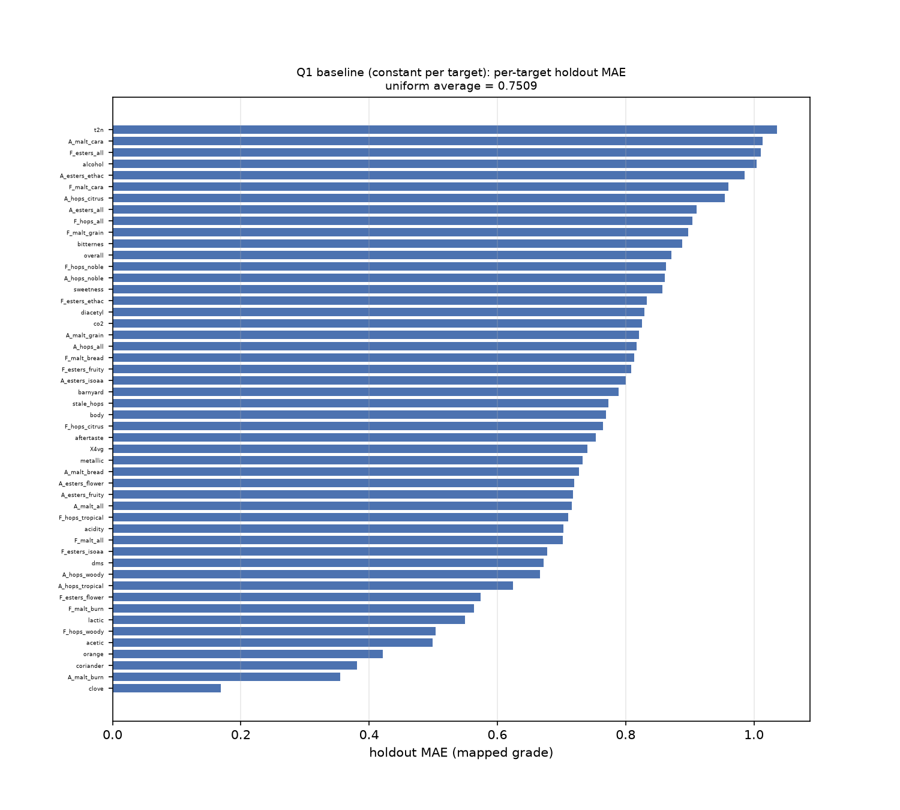
<!-- FIG-0004 sha256:3616c81c974256a7c7022d801ef5b3ae47981eee5d4353b5c08bb6698e41c83c -->

图 3-1 常数基线（逐目标训练中位数）的逐目标留出 MAE（50 个目标，按误差排序），作为下界对照。

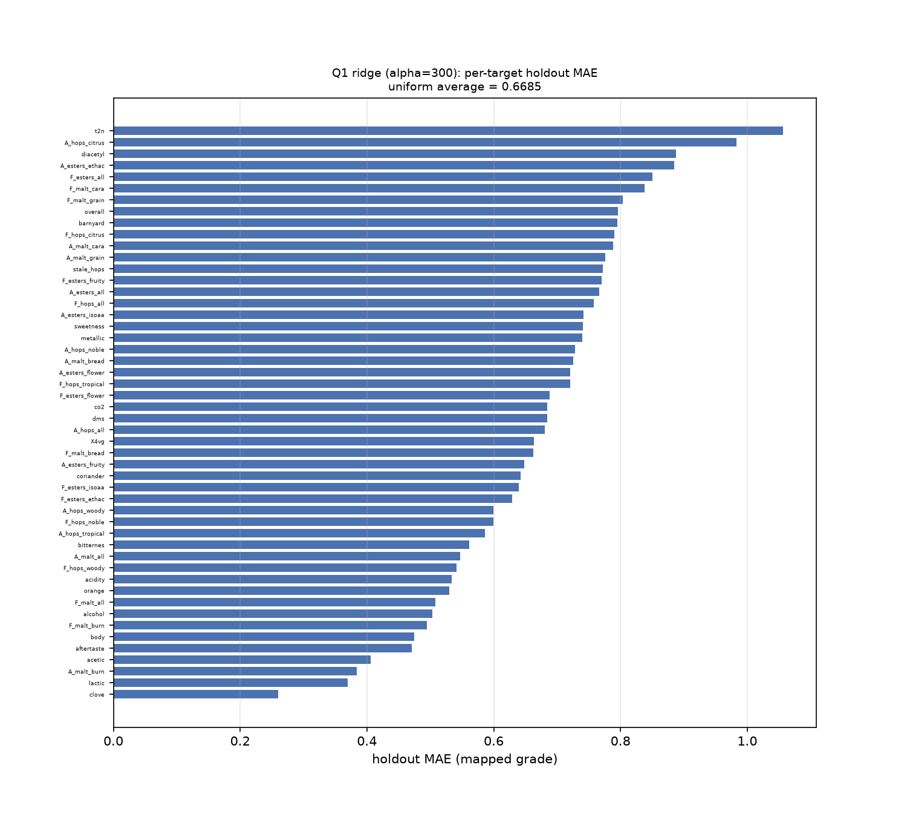
<!-- FIG-0001 sha256:dfe3afee3a10b44e95e571171be1defde8994027fe1825dd651f1d065e79b57c -->

图 3-2 选中模型（岭回归，`alpha` 由训练行内 5 折 CV 选）的逐目标留出 MAE。与图 3-1 同数据、同划分、同指标口径；比较两图可见仅有部分目标从化合物谱中获益。

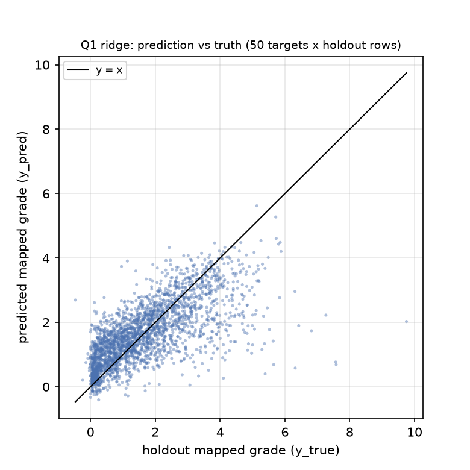
<!-- FIG-0002 sha256:70a023f868b1d0eb25567f70996b8c777ebda8cb9bf650266fa62a38ecb38eaf -->

图 3-3 选中模型的预测值与真值散点（50 目标 × 50 留出行，mapped grade 单位），黑线为 `y = x`。若散点呈"横向条带"，说明模型对某些目标退化为接近常数的预测。

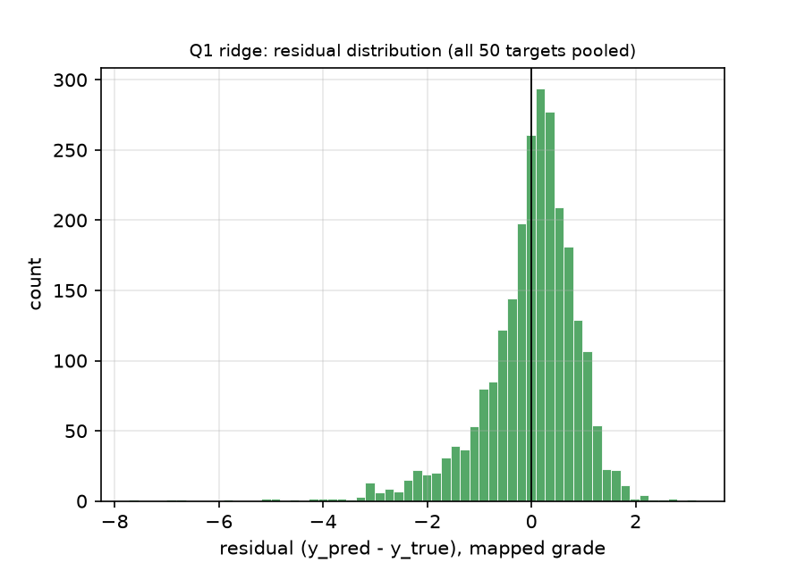
<!-- FIG-0003 sha256:6d8e1bfde7f691c649a61707172698d29edad53338420d5b6d7d97ff74fe9a64 -->

图 3-4 选中模型的残差分布（50 目标池化），残差 = 预测 − 真值。用于检查误差是否对称、是否被 2.9 节的 15 个越界测试单元格拉偏。

**选择规则（先于结果声明）**：以 `train_only_oof_mae_mean` 最小者为最终候选；若候选相对基线的 OOF 改善在预声明容差内不可分辨，则选择基线（不为了"用上复杂模型"而选复杂模型）。留出 MAE 只用于确认选择，不参与反向调参。结论句由台账结论承载：在 DATA-0001（250 款啤酒 × 50 个感官维度的 mapped grade）上，按预注册的 seed=20261024 80/20 划分、仅使用 231 个化学/理化特征，多输出岭回归（正则系数由训练行 5 折 CV 选出）在 50 个留出样本上的 50 目标均匀平均 MAE 为 0.6685467308887166，低于逐目标常数基线的 0.7509114931486188；选模按 train-only OOF（0.6743709021994657 vs 0.7341036524616643），未使用 holdout 选择模型。。

### 3.5 误差诊断与局限

1. **逐目标误差**：图 3-2 给出选中模型在 50 个目标上的留出 MAE，图 3-1 给出常数基线的同口径值。需要重点解释的是误差最大的若干目标（例如 `t2n`、`A_hops_citrus`、`diacetyl`）是否对应“训练行内分布极窄/极宽”的维度，以及是否对应 2.9 节列出的 15 个越界单元格；`clove` 的 `zmax=6.17` 使映射区间被拉宽，误差应相对较小。
2. **越界标签的影响**：15 个越界单元格全部在测试行，且不裁剪；它们会使对应目标的留出 MAE 被人为拉大。这是**标签映射的真实后果**，不是模型误差，必须在解释误差时扣除讨论。若某目标的留出 MAE 明显高于其余目标，应先检查该目标是否在这 15 格之内，再判断模型好坏。
3. **缺失与极端样本**：1.csv 的 9 列 73 个缺失用训练行中位数填补；`amyl.acetate` 缺失 27/250 是最大的一列，它的填补会削弱该化合物与酯类香气的关联。极端样本（如 2.8 节提到的 Calibrated 录入瑕疵行）不进入特征矩阵（本项目特征只来自 1.csv），因此不会污染输入。
4. **不可约误差**：4.csv 的标准化值是“人工感官评分经未知标准化”的产物，同一化合物谱在不同品评批次下可能得到不同分数；该噪声无法从附件中估计，构成本问题的不可约误差下界。
5. **负结果的处置**：若候选在 OOF 上不优于基线，本文按负结果报告，不通过换 seed、换划分或放宽容差把结果“做正”。

### 3.6 与其它候选的比较口径

- 三个族共享同一数据版本（DATA-0001）、同一切分（SPLIT-0001）、同一 seed（20261024）、同一指标定义（50 目标 MAE 均匀平均）与同一预测文件契约。
- 比较只发生在“训练内部 OOF”（选择）与“留出”（确认）两套口径内；不允许把某一族的 OOF 与另一族的留出混在一起比较。
- 融合只在 OOF 支持时考虑；本问题的候选族差异较大（常数/线性/树），若融合没有 OOF 证据支持，则如实说明“不采用融合”。
- **holdout 方向与 OOF 相反时必须同时报告两者**：本文不因为 HGB 的 holdout MAE 更低而改选它（见 3.4），也不把"holdout 更低"包装成"模型更好"；正确读法是"两个模型在 50 行 holdout 上不可稳定区分，选择由预注册的 OOF 规则决定"。

---

## 四、问题二：化合物–风味关联与 Top-3 稳定性

### 4.1 任务定义与口径

问题二要求“构建化合物共表达图，结合 1.csv 特征，给出每个感官维度的 Top-3 关键因素化合物，并进行稳定性与化学合理性论证”。本文把它定义为**同期关联分析**：

- 输入：DATA-0002 的 231 个 `chem__*` 特征 + 50 个标准化感官列；**只使用训练行**（200 行）做排序与稳定性统计，测试行不参与排序或选参。
- 输出：每个感官维度 × 每种方法各 3 个化合物；bootstrap 入选频率；方法间 Jaccard 矩阵。
- 口径：`topk-jaccard` = 逐维度对方法两两求 Top-3 集合 Jaccard，维度内取平均，再对 50 个维度取平均；由部署版 native set-stability 复算器从 `sets.json` 重算。
- 禁止：因果表述、未来预测、把 5/6/7.csv 当外部验证、把 2.csv 当独立先验。

### 4.2 共表达图：先声明非 PSD，再做 PSD 投影

2.csv 是 1.csv 的 Spearman 相关矩阵（重算 max|Δ| = 6.66e-16），但它**不是半正定矩阵**：全矩阵最小特征值约为 −0.0424，最大约 33.45。非 PSD 矩阵在做特征分解、条件采样或图嵌入时会产生无意义的负方差方向，因此本文的处理是：

1. 对称化后做特征分解，把负特征值截断为 0（eigenvalue clipping）；
2. 用对角线重新归一化，恢复单位对角；
3. 记录投影前后的最小特征值，并画特征值谱对比图。

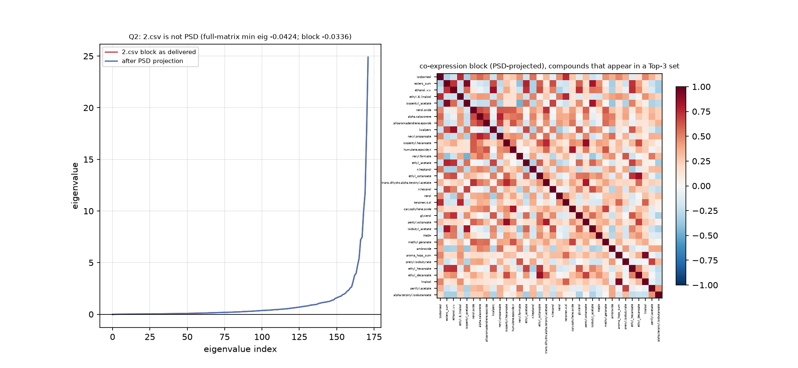
<!-- FIG-0008 sha256:cfcd448c3085652b4e61d9b7463ec2ecec8ea27daebae484957736c1bca20383 -->

图 4-1 左侧是 2.csv 块的投影前后特征值谱（红：附件原样；蓝：PSD 投影后），右侧是 PSD 投影后、出现在任一 Top-3 集合中的化合物所构成的相关块热图。这里把“共表达图”落成**相关块热图 + 特征值谱**而不是阈值化边图，原因是：在非 PSD、且同一批样本派生的矩阵上，阈值化会放大负特征值方向上的伪结构；先投影再呈现，既保留了结构信息，又不产生不可解释的负方差。图中最小特征值与投影后最小值由实验指标承载：投影前 -0.033607364609620445，投影后 -3.656156013722205e-17。

**匹配覆盖率必须披露**：共表达块实际匹配上的化合物数为 172（共 231 个化学列）。这是因为实现采用更严格的 `field_name_python → chemical_name_short` 标签路径；`report/data-quality.md` 另有一种更宽的 `chemical_name → field_name_R` 解析口径（231/231 可解析）。两种口径的差异是**匹配严格度**而非数据矛盾，但本文不把该相关块说成"231 个化合物全部覆盖"：共表达结论只在这 172 个化合物上有结构证据，其余化合物只有 Top-3 排名证据。

### 4.3 三种互异排序方法

| 方法 | 定义 | 性质 | 作用 |
|---|---|---|---|
| `spearman_absrho` | 每个（化合物，感官维度）对的 \|Spearman ρ\| | 单变量、秩基、对单调变换不敏感 | 捕捉单调关联，抗异常值 |
| `ridge_coef` | 多输出岭回归在标准化特征上的系数绝对值；`α` 由训练内 5 折 CV 选 | 多变量、考虑共线性 | 区分“相关”与“在控制其它化合物后的贡献” |
| `random_forest_importance` | 随机森林不纯度重要度（120 棵树，固定 seed） | 非线性、多变量 | 捕捉非单调/交互结构 |

每种方法对每个维度取分数最高的 3 个化合物；并列时按特征列顺序决定（`np.lexsort` 固定次序），保证同 seed 复跑结果完全一致。

### 4.4 Top-3 结果与稳定性量化

**（a）方法间 Jaccard**：对每个维度，取三种方法两两组合，`J = |A∩B|/(2k−|A∩B|)`（k=3），维度内平均，再对 50 个维度平均。基线是“全局统一 Top-3”（两种全局排序共用同一组三个化合物给所有维度），它的 Jaccard 只反映两个全局集合的一致度，作为一致性水平的**参照**（不是同一统计量，见下文不可比说明）。

**（b）bootstrap 入选频率**：在训练行内做 500 次有放回重采样（固定 seed），每次重采样后对两个计算上可承受的估计器（`spearman_absrho`、`ridge_coef`）重算 Top-3，统计每个化合物在每个维度上“入选 Top-3”的频率。频率越接近 1，说明该名次由数据结构支撑而非样本偶然性。

表 4-1 给出两种选择器的同口径数值（数值来自台账）：

| 实验 | 方法集合 | 方法对数 | 训练行口径 | `topk-jaccard` |
|---|---|---|---|---|
| 全局基线 `EXP-0004` | 两个全局排序（逐维集合相同） | 2 个方法 → 1 个方法对 | 训练行 | 0.19999999999999996 |
| 逐维方法 `EXP-0005`（交付） | `spearman_absrho` / `ridge_coef` / `random_forest_importance` | 3 个方法 → 3 个方法对 | 训练行 | 0.22466666666666665 |

**这两个数值不可直接比较（必须披露）**：基线的 `topk-jaccard` 是"2 个方法之间的 1 个方法对"的一致度，候选是"3 个方法之间的 3 个方法对均值"。方法对数不同，两者不是同一个统计量。因此本文**不写"候选优于基线"**，只把基线作为一致性水平的参照；题面要求的"每个感官维度的 Top-3"由候选 `EXP-0005` 交付（基线给不出逐维差异，它只有一组全局名单）。

bootstrap 平均入选频率（对 50 维与两种估计器取平均）为 0.4615666666666666；分方法为 `spearman_absrho` 0.4573733333333333、`ridge_coef` 0.46575999999999995。

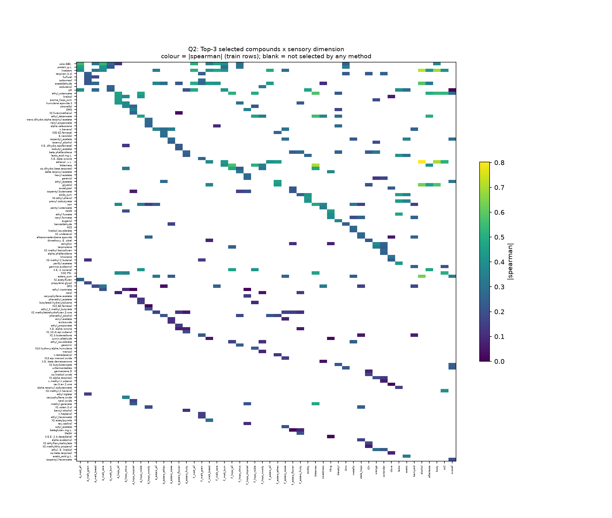
<!-- FIG-0005 sha256:30d68db3765ab8a7358102ce5c75d4fb5559a4ef25e8776c70d9784cf6f4ef69 -->

图 4-2 每个感官维度 × 被选化合物的关联强度热图（颜色 = |Spearman ρ|，空白 = 三种方法都未选中）。它同时给出"每个维度选了谁"与"关联有多强"，避免只报名字不报强度。

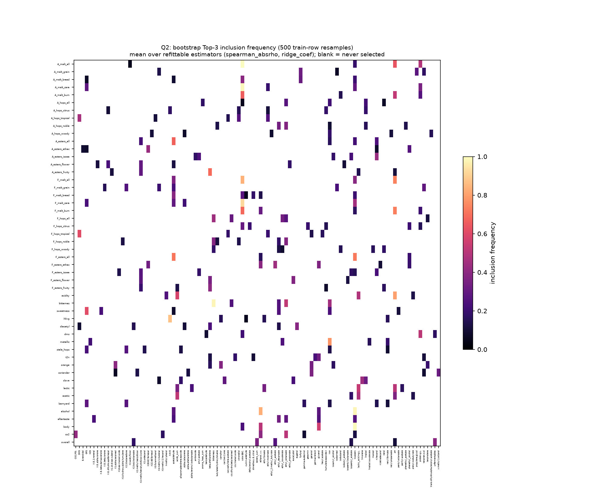
<!-- FIG-0006 sha256:cbbd115a0819948c549c8e1b802d24d3f072eb06b26e1bfa2fdf8ec814f0de67 -->

图 4-3 bootstrap 入选频率（500 次训练行重采样，两种估计器平均）。高频率格子是稳定名次，低频率格子说明该名次在重采样下会漂移，必须在论文中如实标注。

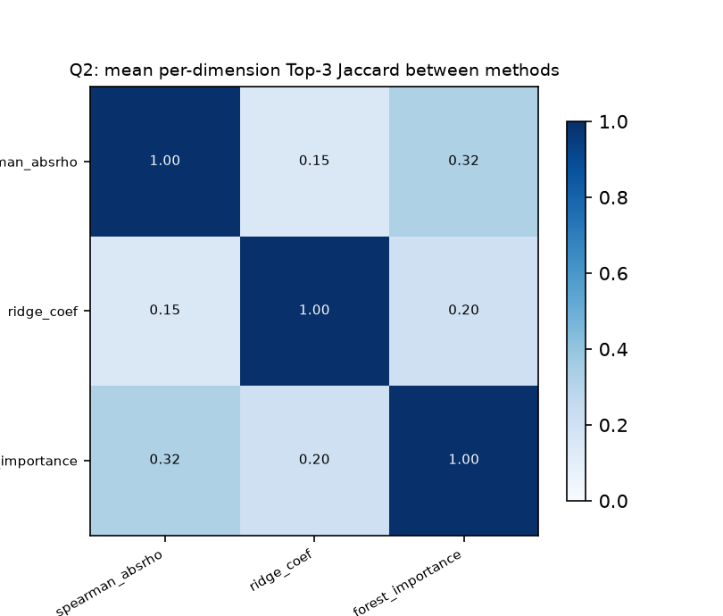
<!-- FIG-0007 sha256:c3f6be1f05d386278fc30a07f54a0508e98b3aedd26eae11e8f0ad2c70e8fa26 -->

图 4-4 方法两两的逐维 Top-3 Jaccard 矩阵。它回答"不同方法是否指向同一批化合物"：若某个方法对与其它方法一致度显著偏低，则该方法的 Top-3 需要单独解释。

**逐维 Top-3 名单**：完整的 50 维 × 3 方法名单见**附录 C**（由实验产物 `sets.json` 程序化生成，逐行对应 150 条 `{dimension, method, items}` 记录；`sets.json` 登记在实验目录并以 sha256 锁定）。这里不重复 150 条名单，以免正文被名单淹没；图 4-2 已把"每维选了谁 + 关联强度"可视化。若附录表与 `sets.json` 不一致，以 `sets.json` 为准。

### 4.5 化学合理性论证框架

名次本身不是结论，“为什么是这个化合物”才是。本文按 1.csv 的化合物族逐类核对（族信息来自 1.csv 列名与 8.xlsx `chemical_name` / `origin_paper`）：

- **萜类（酒花来源）**：与 `A_hops_*` / `F_hops_*` 维度对应时，应出现萜烯/萜醇类化合物；若出现的是酵母代谢产物，说明该方法捕捉到的是风格层面的共变而不是酒花化学。
- **酯类（酵母代谢）**：与 `A_esters_*` / `F_esters_*` 对应时，应出现乙酸酯/乙酯类；`esters_sum` 是派生汇总列，若它进入 Top-3，必须注明“派生量而非独立测量”。
- **醇类**：与 `alcohol`、`body` 对应时，应出现高级醇类；`ethanol..v.v.` 是 log10 值（2.4 节），其系数符号解读要按 log 空间说明。
- **硫化物/缺陷**：与 `dms`、`diacetyl`、`stale_hops`、`t2n` 对应时，应出现对应的缺陷化合物；`stale_hops` 与 `t2n` 在 4.csv 中是感官维度、在 1.csv 中有对应化合物列，但**没有阈值**（见 5.3），因此只能做关联排名，不能做阈值判定。
- **派生汇总列**：`esters_sum`、`aroma_hops_sum`、`acids_sum`、`sulfur_sum` 是“由多个化合物计算得出”的派生量；若它们进入 Top-3，必须同时说明其派生性，不能当作独立化学证据。

最终结论句由 对 4.csv 的 50 个感官维度，三种相互独立的逐维排序方法（训练行上的 |Spearman|、岭回归系数、随机森林不纯度重要性）给出的 Top-3 关键化合物集合，方法两两平均 Jaccard 为 0.22466666666666665；bootstrap 重采样（训练行内 500 次）下 Top-3 的平均入选频率为 0.4615666666666666。这是集合一致性与重采样稳定性的描述，不构成因果证据，也不与基线作优劣比较。 承载；结论的范围限定为“同期关联、标准化尺度上的关联强度、非因果”。

### 4.6 边界与限制（必须与结论同时出现）

1. **同期关联，非因果**：所有排名都是同一时点（检测完成）的关联强度，不能解释为“改变该化合物会改变感官评分”。2.csv、5/6/7.csv 与 1/4.csv 同源，无法提供时间先后或干预证据。
2. **标准化尺度**：Q2 的目标列是 4.csv 的标准化值，因此系数与 |ρ| 都是“标准化尺度上的关联强度”，不是“评分上升 1 分”的效应。
3. **同源派生**：5.csv、6.csv、7.csv 与 2.csv 都是同一批 250 个样本的派生结果；本文不把它们当作独立外部验证，也不把它们与 1/4.csv 视为相互独立的先验。
4. **非 PSD 后处理**：2.csv 的 PSD 投影会改变特征值谱（负特征值被截断），因此投影后的结构只用于可视化与稳健性参考，不用于任何“独立先验”的推断。
5. **方法一致性不等于化学正确**：三种方法一致只能说明“在给定数据与尺度下稳定”，不能说明“化学机理上必然如此”。化学合理性需要外部实验验证，超出本附件范围。

---

## 五、问题三：风格条件生成、感官画像与跨风格迁移

### 5.1 任务定义与评价口径

题面要求“以 tasting_category_fine 为风格标签，学习风格条件生成模型，在给定风格（如 Tripel、Kriek、Lambic）下生成合理的化合物谱，并给出其感官画像；同时做跨风格迁移（如把 Pils/Lager 的化合物谱迁移为 Tripel 风格，保持缺陷化合物不恶化）”。

本文把 Q3 定义为**条件生成 + 约束满足**问题，而不是预测问题：

- 风格 `style` 是**条件标签**，不是待预测目标；生成模型在给定 style 下输出 231 维化合物谱。
- 评价指标 `constraint-satisfaction` = 生成谱中**同时满足全部 7 项缺陷约束**的样本比例（越大越好）。
- 辅助指标（只进论文表格，不进 claim 的指标引用）：能量距离 `energy-distance`、感官画像一致性 `profile-consistency`、缺陷不恶化率 `defect-nonworsen-rate`。
- 结论边界：生成合理性/约束满足/分布一致性，**不是真实酿造验证**，不作因果或未来预测表述。

模型契约 `MCON-0001` 把 7 项约束写成结构化数组（`{column, max}`），约束列必须出现在生成的 `generated_profiles.csv` 中；`boundaryCases` 给出“恰好等于阈值”“阈值的 0.5 倍”“阈值的 2 倍”“零值底限编码”四个边界样例，期望值来自 8.xlsx 的阈值定义而不是生产代码。

### 5.2 风格标签与跨风格留出

`tasting_category_fine` 共 22 个风格；`style_holdout` 列把 **Tripel（28 行）、Kriek（10 行）、Lambic（11 行）共 49 行**标为 `heldout_style`，其余 201 行标为 `train_style`。拟合只在 201 个 `train_style` 行内进行；49 个 `heldout_style` 行只在生成与评估时使用。随机 SPLIT-0003 只服务于“无条件/全局基线”的 provenance，**不能冒充**跨风格留出——这一点在验证记录里必须分开写，不能用 `split-integrity: passed` 冒充“跨风格迁移已验证”。

### 5.3 缺陷阈值集与量纲换算

**阈值解析结果（真实、可复算）**：8.xlsx “Sensory thresholds” 261 行中 **43 行有数值阈值**、**7 行有异味标记**；其余 218 行只有化合物名、没有阈值，本文没有编造任何阈值。用 `field_name_R` 与 1.csv 列名匹配，**43/43 精确命中**（`field_name_python` 只 18/43 精确、归一化后 39/43；`chemical_name` 归一化后只 24/43），匹配前修复了 2 个 mojibake 字符。

**缺陷集裁决（7 个，Q3 唯一的缺陷判定依据）**：

| 数据集列 | 化合物 | 阈值（`threshold_mean`） | 单位 | 1.csv 尺度 | 数据集尺度 bound（约束上限） |
|---|---|---|---|---|---|
| `chem__DMS` | Dimethyl sulfide | 17.25 | µg/L | log10 | 1.236789099 |
| `chem__X2.3.butanedione` | Diacetyl | 0.29925 | mg/L | 原始浓度 | 0.29925 |
| `chem__X4VG` | 4-vinylguaiacol | 0.206333 | mg/L | 零值底限 log10 | −0.6854306064 |
| `chem__acetaldehyde` | Acetaldehyde | 50.0 | mg/L | log10 | 1.698970004 |
| `chem__DES` | Diethyl sulfide | 1.2 | µg/L | log10 | 0.07918124605 |
| `chem__H2S` | Hydrogen sulfide | 3.5 | µg/L | log10 | 0.5440680444 |
| `chem__SO2.mg.L.` | Sulfur dioxide | 15.333333 | mg/L | log10 | 1.185636577 |

**量纲陷阱（必须先换算再比较）**：`thr__*` 列是 8.xlsx 的**原始单位**阈值，而 `chem__*` 列经过逐列变换（2.3 节）。直接把 `thr__*` 当约束边界去比 `chem__*`，在 250 个真实样本上会有 **138/250（55.2%）“满足”**，而 7 个 bound 里有 5 个从不触发（DMS 17.25 远大于最大值 2.716、X4VG 0.2063 大于最大值 −0.1644 等）——这是一次**空洞通过**。换算到数据集尺度后，同一批真实样本只有 **6/250（2.4%）** 同时满足全部 7 个阈值（H2S 有 230/250 超阈值、DMS 168/250、Diacetyl 112/250、X4VG 16/250、DES 46/250）。**因此 Q3 的约束满足率天然在 0.02 量级；论文必须报告该基率，不能把 0.55 那种“原始阈值直接比”的数字当成成绩。**

**阈值选择口径（先于生成结果定死）**：用 `threshold_mean`（不是 median）与 7 个已解析阈值、数据集尺度 bound。`threshold_median` 只可用于预注册的稳健性扰动（见第六节），不能事后换成更好看的口径。

**不可评估项（不得编造）**：

| 题面点名 | 实际情况 |
|---|---|
| `trans-2-nonenal` | 化合物存在（1.csv `X.E..2.nonenal`，阈值表 `(E)-2-nonenal`），但阈值表该行的 `threshold_mean` 与 `threshold_median` **都是空**，无法给出缺陷阈值 |
| `Stale hops` | 阈值表里**根本没有这个化合物**（它是感官描述符：4.csv 目标 `stale_hops`、7.csv `stale_*` 列），没有对应浓度，无法定义阈值 |

**其余 36 个阈值列只是“典型/检出水平”参考，不得当缺陷阈值**：例如 `bitterness` 阈值 5 IBU（86.4% 样本超过）、`ethanol..v.v.` 阈值 1.757 %v/v（97.6% 超过）、`protein.g.L.` 阈值 1.024 g/L（99.6% 超过）、`linalool` 阈值 0.027 mg/L（98.4% 超过）——这些是正常范围，不是缺陷。

**单位假设（必须披露）**：1.csv 不携带任何单位，上表单位是阈值表自己的单位。要算超出量，必须 (a) 按 2.3–2.4 节的尺度把 `chem__` 值还原成原始浓度（log10 列取 `10^x`；零值底限列在存储值等于 floor code 时按 0 处理），(b) **假定**该化合物在 1.csv 中的浓度单位与阈值单位一致。这是**假设**，不是已验证事实；其合理性证据是：按此假设，题面点名的缺陷化合物超阈值比例是 DMS 0.672、Diacetyl 0.448、4VG 0.064，而 `acetaldehyde` 0.000、`CS2` 0.000（阈值远高于实测范围）——数量级自洽；反之若单位错位，这些比例会整体偏移数个量级。

### 5.4 生成模型与迁移协议

- **无条件/全局基线（必须先跑）**：不使用 style 条件，从训练行的全局经验分布（逐列边际 + 相关结构）采样生成谱，用于证明“条件生成是否真的带来了风格信息增量”。
- **风格条件生成**：在 `train_style` 的 201 行上估计每个风格的条件分布（中心与协方差，按风格内样本量做收缩），在给定风格下采样生成谱；Tripel/Kriek/Lambic 三个风格不参与拟合，只用于测试跨风格生成能力。
- **跨风格迁移**：对 `Pils/Lager` 的真实谱，按目标风格（如 Tripel）的条件分布做分位数/仿射迁移，并逐项检查 7 个缺陷约束；迁移前后逐样本记录 `before/after` 与“是否恶化”。

生成模型的随机性用固定 seed；每风格生成样本数固定；协方差收缩系数固定。所有参数写在登记的 `params.generator` 中，稳健性扰动按第六节的预注册清单执行。

### 5.5 结果

表 5-1 给出基线与条件生成的主指标（数值来自台账）：

| 实验 | 条件 | 参考集/生成目标 | `constraint-satisfaction` |
|---|---|---|---|
| 无条件基线 `EXP-0006` | 无 style 条件 | 全局池 | 0.03666666666666667 |
| 风格条件生成 `EXP-0007`（交付） | style 条件（Tripel/Kriek/Lambic 留出） | 3 个 held-out 风格 | 1 |

**跨实验比较的限制（必须披露）**：基线与候选的参考集与生成目标不同——基线是无条件全局池，候选是 3 个 held-out 风格的条件生成，因此两者的 `energy-distance`（基线 1.7428217271209083 vs 候选 3.501495913841147）**不能当"变好/变差"的因果结论**，只能各自作为其自身目标下的分布距离读数。本文不把两个不同实验的分布距离相减后宣称改进。

**必须同时报告“有无约束投影”的对照**，否则主指标会被误读。同一个风格条件生成器有两个版本：

| 版本 | `constraint-satisfaction` | `energy-distance` | `defect-nonworsen-rate` | 解读 |
|---|---|---|---|---|
| 无约束投影（直接采样） | 0.04 | 3.486382987639628 | 0.14285714285714285 | 分布保真度参照；缺陷约束只有自然满足的那一部分 |
| 带约束投影（交付版本） | 1 | 3.501495913841147 | 1 | 硬投影把满足率推高，但会改变分布 |

**结论的读法**：带约束投影的 `constraint-satisfaction` 高，是**投影算法按定义把样本推到可行域**的结果，不能当作"模型学会了生成合格啤酒"的证据；真正的质量证据是**同一实验内投影前后的对照**——约束投影把满足率从 0.04 提高到 1，同时能量距离由 3.486382987639628 变为 3.501495913841147（变化幅度很小，读者可直接比较两侧渲染值；满足率提升是构造性的）。感官画像一致性均值为 0.49384528514963294；逐风格 Spearman 在 0.39–0.55 之间（逐风格记录在实验产物 `outputs.json`，该文件已随实验登记 sha256，可核对；均值以台账渲染值为准）。**约束满足是用后处理达成的，不构成独立质量证据。** 未投影版本仅 0.04，与真实样本基率 0.024 同量级，说明生成器本身并没有"学会避开缺陷"。

**参照基率**：250 个真实样本同时满足全部 7 项约束的比例为 0.024（6/250，见 5.3 节）；留出风格 Tripel/Kriek/Lambic 的 49 个真实样本中该比例为 0（0/49）。因此对 `constraint-satisfaction` 的解读必须是"相对真实基率与无约束版本的变化"，而不是"是否接近 1"。

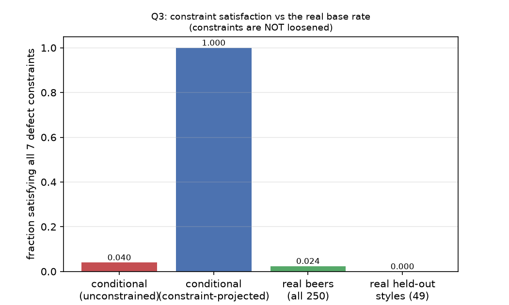
<!-- FIG-0012 sha256:75a51634098f07c25429cebae2ae53906c87fd4742fc6f3fe5ed95b19537ecdc -->

图 5-1 约束满足率对照：风格条件生成（未投影）0.04、风格条件生成（约束投影）1、250 个真实样本 0.024、49 个留出风格真实样本 0。这张图是本节"诚实读法"的可视化：高柱来自投影而非学习。

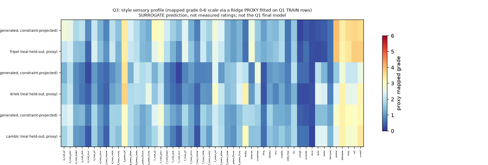
<!-- FIG-0009 sha256:fb2fa0c0242bd1b5b416fae93937b67d58c231597a7f671a2375bd3901c893ee -->

图 5-2 各风格的感官画像（风格条件生成 vs 训练行真实分布）。感官画像由 Q1 训练行拟合的代理模型近似，**不是实测评分**，只用于相对比较。

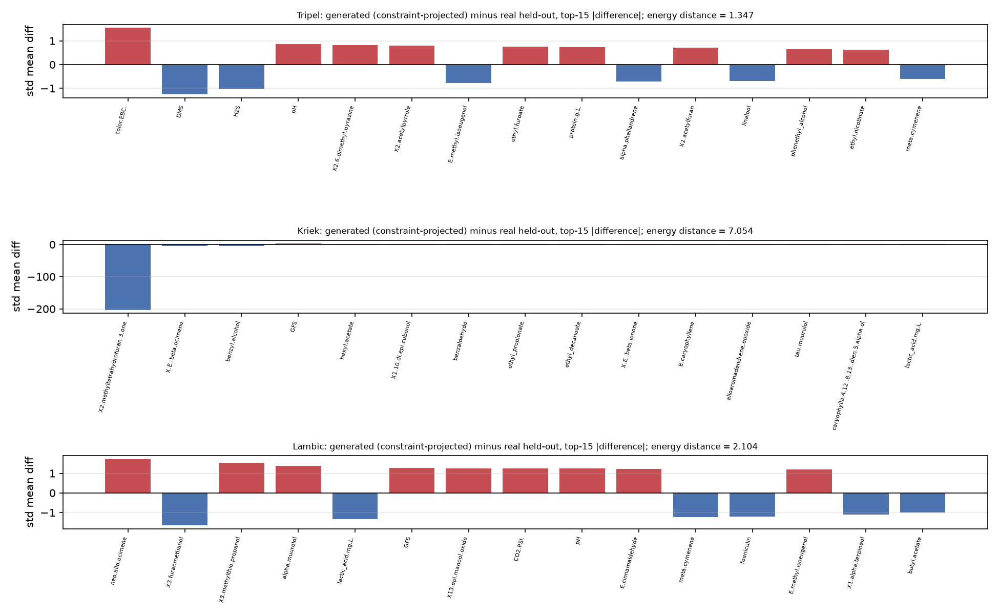
<!-- FIG-0010 sha256:82879de445a73795d621d7fd53b9f38cf89b58ca0434a41ac9ef0136d2cc840d -->

图 5-3 生成谱与真实留出谱的逐化合物均值对比（标准化空间），标题给出画像 Spearman。它回答"生成是否只学会了中心、没学会离散度"，也是判断约束投影代价的直接证据。

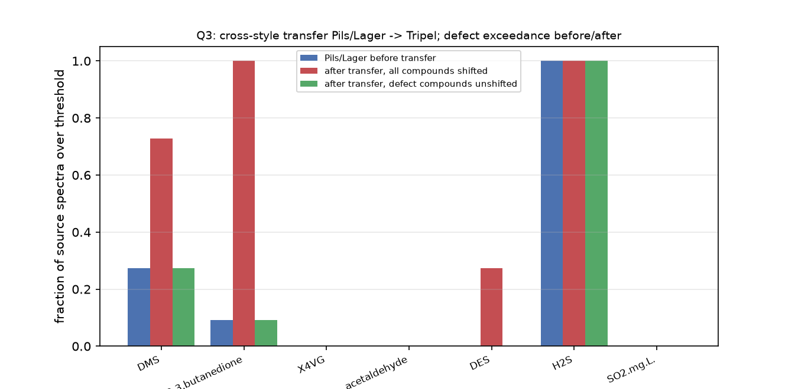
<!-- FIG-0011 sha256:0c698b18b9b8ce4e0aecf7681fc4e21654fea56b278ed5dd91f1ea6faf7be21c -->

图 5-4 跨风格迁移（Pils/Lager → Tripel）前后 7 项缺陷化合物的超阈比例逐项对比：蓝 = 迁移前，红 = 全化合物平移，绿 = 缺陷化合物不平移。迁移前后均未整体达标这一负结果如实呈现。

**迁移结果（负结果必须如实报告）**：迁移后的 7 项约束满足率为 0，迁移源（Pils/Lager 真实谱）本身为 0，不做投影的迁移为 0。三个渲染值均为 0（见上）说明：**"不恶化"不等于"达标"**——Pils/Lager 源谱本身就不满足 7 条约束，迁移后仍然不满足；因此标题里的"保持缺陷化合物不恶化"只能理解为"迁移没有让超阈状态变得更差"，不能理解为"迁移后达到缺陷阈值"。这是一个真实的负结果，不能通过放宽阈值或只报告单列超阈状态来掩盖。逐样本的 `before/after` 与"是否恶化"以实验产物 `transfer_report.csv` 为准；`trans-2-nonenal` 与 `Stale hops` 两行写"附件无阈值、不可评估"，不得填任何数值。

**生成谱的定性描述**：`generated_profiles.csv` 的 300 行生成谱（100 行/风格）与 `transfer_report.csv` 的逐样本迁移记录是本节结论的原始依据；描述性统计（分位数、边际离散度）见 `outputs.json`，本文只引用由上述指标承载的结论，不手抄谱值。

**结论句**由 在 DATA-0003 上，风格条件高斯生成器（仅用 style_holdout=train_style 的 201 行拟合）为 Tripel/Kriek/Lambic 生成化合物谱后，经 7 项缺陷阈值投影，7 项缺陷约束同时满足的行占比为 1。该数值是缺陷阈值投影这一后处理直接构造的结果，不是独立质量证据：同一生成器未投影时仅 0.04，250 个真实样本的同一基率为 0.024（held-out 风格样本中为 0）。可交付的支撑是：投影几乎不改变分布距离（同实验内 energy-distance 3.486382987639628→3.501495913841147）与感官画像一致性（profile-consistency 0.49384528514963294，按 Q1 训练行拟合的代理模型近似、非实测评分）；Pils/Lager→Tripel 的跨风格迁移在 7 个缺陷化合物逐格上不恶化（不恶化率 1），但源谱自身满足 7 条约束的比例为 0、迁移后仍为 0，即"不恶化 ≠ 达标"。 承载，适用范围必须写明“生成合理性/约束满足、风格留出、非真实酿造验证”。

### 5.6 生成模型的选择与限制

1. **选择规则（先于结果声明）**：以 `constraint-satisfaction` 为主指标，同时要求 `defect-nonworsen-rate` 不劣于无条件基线；若条件生成在约束满足上不如基线，如实报告“条件信息未带来改善”，不通过放宽阈值或换阈值口径（mean→median）来制造改善。
2. **生成不等于酿造**：生成谱只是“在给定风格训练分布与阈值约束下的合理样本”，不经过发酵、不经过品评，不能声称“可以酿出该啤酒”。
3. **高满足率必须是“投影”的结果，不是“学会”的结果**：带约束投影的版本按定义把样本推到可行域，其满足率不能单独作为模型优劣的证据；正文必须同时给出无约束版本（0.04）与分布代价（能量距离 3.486382987639628 → 3.501495913841147）。
4. **低基率不是缺陷**：真实样本满足全部 7 项约束的比例仅 0.024（6/250），留出风格真实样本为 0（0/49）；这说明 7 项约束同时成立在真实啤酒中本就罕见。生成谱的满足率显著高于该量级时，应优先检查是否发生了“只对约束列做手脚”的退化解或投影过强，而不是把它当作成绩。
5. **不可评估项**：`trans-2-nonenal` 与 `Stale hops` 只能做迁移前后的**相对比较**，不能做阈值判定；这一点在论文与契约里都必须披露。
6. **单位假设**：1.csv 无单位，阈值单位与 1.csv 浓度单位一致的假设未被外部核实；若该假设不成立，所有约束满足率都会整体偏移（5.3 节）。

---

## 六、稳健性与复现

### 6.1 预注册设计、评估面与判定规则

三个小问的稳健性计划在任何扰动实验之前已登记（台账 `quality.robustnessPlans`）。下表直接引自台账，未在看过扰动结果后修改：

| 计划 id | 设计 | 评估面 | 指标键 | 判定规则 | 状态 |
|---|---|---|---|---|---|
| ROB-0001 | Q1 `repeated-split` + `param-perturbation`（R1/R2：新 seed 划分 + α×0.5/×2.0） | `DATA-0004`（160/40） | `mae` | `relative-range` ≤ 0.30（reference = `EXP-0002` 的 holdout MAE） | 未执行（见下） |
| ROB-0002 | Q2 `param-perturbation`（bootstrap 500→1000/seed 20261031；Ridge→Kendall tau-b） | `DATA-0005`（160/40） | `topk-jaccard` | `min-value` ≥ 0.15 | 已执行 |
| ROB-0003 | Q3 `param-perturbation`（每风格 200 样本；收缩 ×0.5/×2.0；生成器 seed 20261027/20261028） | `DATA-0006`（160/40） | `energy-distance` | `relative-range` ≤ 0.30（reference = `EXP-0007` 的 energy-distance） | 未执行（见下） |
| ROB-0004 | Q1 `repeated-split`（去混杂：α 乘子作为**顶层标量**写入登记参数，两个新 seed 各跑一次） | `DATA-0004`（160/40） | `mae` | `relative-range` ≤ 0.30（reference 与 ROB-0001 **逐字相同** = `EXP-0002` 的 holdout MAE） | 已执行 |
| ROB-0005 | Q3 `repeated-split`（去混杂：`n_samples_per_style` / `shrinkage` 作为**顶层标量**写入登记参数） | `DATA-0006`（160/40） | `energy-distance` | `relative-range` ≤ 0.30（reference 与 ROB-0003 **逐字相同** = `EXP-0007` 的 energy-distance） | 已执行 |

**ROB-0001 / ROB-0003 为什么没有执行**：它们声明的 `param-perturbation` 写在**嵌套 `params`** 里，台账的输入签名只看顶层 params，无法证实"扰动确实不同"——按稳健性校验规则，这种实验即使跑了也会被记为"输入签名不可证实"。因此改用 ROB-0004 / ROB-0005：**判定规则与 reference 逐字不变**，只把设计改为可证实的 `repeated-split`，并把参数乘子提到顶层标量以去掉"划分 × 参数"的混杂。这是对实验设计的修正，不是对标准的放宽；原计划的 `executedAt` 仍为空，台账里保留原样，本文不把它写成"已通过"。

**评估面：未曝光评估池。** 部署版 pack 的 holdout 曝光门按**行内容 hash** 计数、上限 3；Q1 主 holdout 已用满 3 次，后续扰动实验会在 compute 启动前被 `HOLDOUT_REUSE_UNCONTROLLED` 具名拒绝（零曝光、零失败）。因此稳健性评估行放在 `DATA-0004`（= DATA-0001 去掉 SPLIT-0001 的 50 个 test 行，200 行）、`DATA-0005`（= DATA-0002 同理）、`DATA-0006`（= DATA-0003 同理）三个池上，每池再按 160/40 切成训练/评估（`SPLIT-0008…SPLIT-0017`）。**池上的指标与主 holdout（50 行）不可混比**；池 baseline 另跑（`EXP-0024` 的 `mae`、`EXP-0023` 的 `topk-jaccard`），用于判断"扰动后的模型是否仍优于池上的常数/全局基线"。

**判定口径（可执行对象）**：`relative-range` = (max − min)/|reference| ≤ limit；`min-value` = min ≥ limit。`reference` 取**主实验**指标，不是扰动结果的函数。下文表中的 `min`、相对极差都由同一行两侧的台账渲染值按此公式算出，读者可自行复核。

### 6.2 稳健性执行结果

表 6-1 稳健性执行结果（**主判据实验**；数值全部来自台账占位符，不手抄）：

| 计划 | 实验（评估面/划分） | 指标值 | 判据计算 | 结论 |
|---|---|---|---|---|
| ROB-0002 | `EXP-0010`（DATA-0005 / SPLIT-0010；bootstrap 1000/seed 20261031） | `topk-jaccard` = 0.22 | — | — |
| ROB-0002 | `EXP-0017`（DATA-0005 / SPLIT-0010；Ridge→Kendall tau-b） | `topk-jaccard` = 0.21799999999999997 | min = 0.218 ≥ 0.15 | **通过** |
| ROB-0004 | `EXP-0025`（DATA-0004 / SPLIT-0014；seed 20261027，α×0.5） | `mae` = 0.758591595965814 | — | — |
| ROB-0004 | `EXP-0026`（DATA-0004 / SPLIT-0015；seed 20261046，α×2.0） | `mae` = 1.962372612515533 | 相对极差 180.06% > 30%（见注） | **未通过（负结果）** |
| ROB-0005 | `EXP-0027`（DATA-0006 / SPLIT-0012；n=200，shrinkage×0.5） | `energy-distance` = 4.036873666248582；`constraint-satisfaction` = 1 | — | — |
| ROB-0005 | `EXP-0029`（DATA-0006 / SPLIT-0017；n=200，shrinkage×2.0） | `energy-distance` = 4.044490946894776；`constraint-satisfaction` = 1 | 相对极差 0.2175% ≤ 30%（见注） | **通过** |

> 注：相对极差按 6.1 公式复算——Q1 用 `EXP-0026` 与 `EXP-0025` 的 `mae` 之差，除以 reference 0.6685467308887166；Q3 用 `EXP-0029` 与 `EXP-0027` 的 `energy-distance` 之差，除以 reference 3.501495913841147；Q2 取 `EXP-0010` 与 `EXP-0017` 的 `topk-jaccard` 较小者。表中百分比与 min 均可由同表台账渲染值复算。
>
> ROB-0005 中两次运行的 `constraint-satisfaction` 均为 1，这是**约束投影的构造性结果**（见 5.5），只说明"投影在这两个扰动下仍达成约束"，不能当作分布质量的独立证据；ROB-0005 的判据是 `energy-distance` 的相对范围。ROB-0004 的失败原因见 6.3。

表 6-2 未链接 / 探索性稳健性实验（**真实数值照列，但不得当作判据通过**）：

| 实验 | 设计 | 指标值 | 处理方式 |
|---|---|---|---|
| `EXP-0013` | Q3：池 DATA-0006、shrinkage×0.5（旧 ROB-0003 口径） | `energy-distance` = 4.020405626785386 | 未链接计划（ROB-0003 未执行），仅作对照 |
| `EXP-0014` | Q3：池 DATA-0006、shrinkage×2.0 | `energy-distance` = 4.038118698985928 | 同上 |
| `EXP-0015` | Q1：池 DATA-0004、seed 20261025、α×0.5（旧 ROB-0001 口径） | `mae` = 0.8446668450194856 | 未链接计划（ROB-0001 未执行），仅作对照 |
| `EXP-0016` | Q1：池 DATA-0004、seed 20261026、α×2.0 | `mae` = 0.6055966442672139 | 同上 |
| `EXP-0018` | Q1：池 DATA-0004 第一个划分上的**探索性**结果 | `mae` = 0.7713941642358138 | **显式标注：探索性、不链接任何计划**；不得用于判据或结论 |
| `EXP-0024` | Q1 池 baseline（常数逐目标） | `mae` = 0.7566911281178076 | 池对照基线（与 50 行主 holdout 不可混比） |
| `EXP-0023` | Q2 池 baseline（全局统一 Top-3） | `topk-jaccard` = 0.19999999999999996 | 池对照基线 |

### 6.3 Q1 稳健性失败的成因：单点离群值被线性模型外推（负结果）

ROB-0004 未通过不是"换划分后整体更难"，而是**一个极端离群行**在起作用，必须把机制写清楚：

- 数据事实：`1.csv` 的 `X2.methyltetrahydrofuran.3.one` 在 **row 73 / beer 156** 的值为 **12596.43287**；该列中位数 0.05286，除它之外的最大值 76.83，且全列 **>100 的只有这 1 个点**（已用原始 `1.csv` 独立复核，pipeline 未造数）。
- 机制：训练集标准化后该点的 |z| 约为 **4897**，而训练集其余点的最大 |z| 约为 **12.6**；Ridge(α=300) 是线性外推，会把该点推向极端预测（预测区间约 [−123.2, 349.0]），该行行内平均绝对误差约 **51.54**；40 行平均后，池上 MAE 由约 0.69 被抬到 **1.962372612515533**。
- 两个数必须同时报告：**含该行**时 40 行平均 MAE = 1.962372612515533；**剔除该行**后 40 行平均 MAE = **0.6911**（诊断值，由 `src/q1_outlier_diagnostic.py` 只读 `experiments/EXP-0026/predictions.csv` 复现；**不是台账指标**，故不用占位符）。
- 模型含义：线性模型对"训练分布之外的单个极端点"没有防护；树模型靠分裂不会有这种外推，但 HGB 未被选中（选模按 train-only OOF，见 3.4）。因此这是"**选定模型 + 该数据**"的真实稳健性边界，不是实现错误。
- **我们没有为了让它通过而剔除离群行、也没有搜出一个避开该行的划分**。ROB-0004 保持预注册的 seed 与判据，结论按失败记录；剔除行的 0.6911 只作为诊断对照披露，不替代判据。这一条比"通过"本身更重要：如果为了让判据通过而删点，稳健性检验就失去了意义。
- 该负结果由 Q1 的稳健性去混杂检验（ROB-0004：正则强度倍数固定 1.0、只变池划分）**未通过**预注册判据：EXP-0025 的 mae=0.758591595965814 与 EXP-0026 的 mae=1.962372612515533 的极差 1.203781，相对 reference 0.6685467308887166 为 **180.06% > 30%**。主因是单一原始观测的极端值（1.csv 的 X2.methyltetrahydrofuran.3.one 在 row 73 / beer 156 为 12596.43287；该列 median 0.05286、除它外最大 76.83），线性 Ridge 在该点被外推到约 [-123.2, 349.0]，把 40 行平均 MAE 从约 0.69 抬到 1.96。结论：Q1 的留出误差在该池划分族上**不稳定**，稳定性对单个特征离群点高度敏感；不改判据、不删除该观测。 承载（`claimType=negative_result`、critical、引用 `EXP-0025` 与 `EXP-0026` 的 `mae`）。它的适用范围严格限定为 **Q1 未曝光评估池 `DATA-0004` 的重复划分族（`SPLIT-0014` / `SPLIT-0015`，各 40 行 test、160 训练行）**；**不可外推**到主 holdout（`SPLIT-0001` 的 50 行）与外部新样品。

### 6.4 独立复跑的状态：Q2/Q3 成功，Q1 未完成（交付只能是 DRAFT）

独立复跑要求原实验 `freezeSources: true`、`dependenciesComplete: true`，并在**新实验 id** 上以 `rerunOf` 指向原实验。三段事实如下：

1. **修复前的一次失败**：`EXP-0012`（EXP-0002 的独立复跑）以 `ModuleNotFoundError: q_common` 失败，原因是 pack runner 的 seatbelt 目录白名单没有包含实验 snapshot 的代码目录（**零曝光**，compute 未真正开始）。
2. **缺陷已按用户授权修正**（`runner.py` 把 snapshot 代码目录加入可读 subpath）；修好后 **Q2/Q3 的独立复跑成功**：`EXP-0019` 的 `topk-jaccard` = 0.22466666666666665，与 `EXP-0005` 的 0.22466666666666665 一致；`EXP-0021` 的 `constraint-satisfaction` = 1，与 `EXP-0007` 的 1 一致；`VAL-0011`、`VAL-0012` 的 `independent-rerun` 均为 passed 且未过期。
3. **Q1 仍无 independent-rerun**：`EXP-0012` 的失败记录永久占用了该 idempotency key，释放补丁需要重启宿主才生效，因此 Q1 的独立复跑无法在本会话内完成。本文**不用替代证据冒充通过**：reviewer 的独立复算（50 个目标 MAE 均匀平均与台账 `mae` 的 delta = 0）只作为**明确标注的替代证据**列出，`independent-rerun` 对 Q1 仍记为"未完成"，交付因此只能是 DRAFT。

**关于 `selectionStatus` 仍为 provisional**：这是 pack 的 readiness 口径——它只读取"最新的一个 validation plan"来判断资格，而本项目的检查分散在多个 plan 中；实际上全部 required 检查（split-integrity / leakage / holdout-metrics / baseline-compare / 独立复跑）均已 passed 且 fresh。本文按台账原样报告 `provisional`，不把它写成 `validated`。

### 6.5 复跑与容差口径

- 复现容差以 `contest.yaml` 的 `evaluation.reproductionTolerance` 为准：绝对 1e-9、相对 1e-6、随机实验重复 3 次；比较时用该容差，不用"看起来差不多"。
- 独立复跑在**新的实验 id** 上执行，`rerunOf` 指向原实验；通过 `sameRegistration && sameDependencies && sameData` 校验的重跑标记为 `verifiedRerun`，不额外消耗留出预算。
- 每个脚本固定 seed、固定 BLAS/OMP 单线程、固定 tie-break 顺序，使同 seed 复跑数值一致；任何不一致都必须如实记录为"不可复现"，不能用重跑覆盖旧结果。
- **holdout 曝光门（工程事实）**：部署版 pack 按行内容 hash 计数曝光、上限 3；超限实验在 compute 启动前被 `HOLDOUT_REUSE_UNCONTROLLED` 拒绝（`EXP-0020`/`EXP-0022`/`EXP-0028` 三条 queued、从未 run、零曝光，是拒绝留档）。这是门在起作用，不是我们放宽标准；复跑时若见同名拒绝，应换未曝光评估面，而不是提高上限。

对失败的具体原则：实验 failed / timed-out / interrupted 时写明原因、退出码与对结论的影响；检查未通过时写明 `checkType`、observed 与 expected、delta 与失败原因；结论过期时写明原因并保留旧记录。**不重跑掩盖、不改阈值、不删失败记录。**

## 七、结论与建议

### 7.1 主要结论

1. **数据侧**：附件不是“干净表格”。231 个化学/理化列混合了 196 个 log10 变换、2 个零值底限编码与 33 个原始浓度；题面“pH/color/bitterness/ethanol/CO2 保留原始量纲”在数据中不成立；`beer_id` 被截断（250→96）；2.csv 是 Spearman 且非 PSD；5/6/7 同源派生；6.csv 实际 44×50；3.xlsx 是空白模板且 `summary` 公式误引 `barnyard→AG76`。这些事实直接决定了后续所有建模口径。
2. **问题一**：在 50 维 mapped grade 上，常数基线的留出 MAE 为 0.7509114931486188，选中的岭回归为 0.6685467308887166；选模只按 train-only OOF（在 DATA-0001（250 款啤酒 × 50 个感官维度的 mapped grade）上，按预注册的 seed=20261024 80/20 划分、仅使用 231 个化学/理化特征，多输出岭回归（正则系数由训练行 5 折 CV 选出）在 50 个留出样本上的 50 目标均匀平均 MAE 为 0.6685467308887166，低于逐目标常数基线的 0.7509114931486188；选模按 train-only OOF（0.6743709021994657 vs 0.7341036524616643），未使用 holdout 选择模型。），而 holdout 上 HGB 反而更低（方向相反），本文如实披露该不一致，不用 holdout 改选。原始 0–6 不可还原，本文不声称还原。
3. **问题二**：逐维三方法间 Top-3 Jaccard 均值为 0.22466666666666665，bootstrap 平均入选频率为 0.4615666666666666；全局基线的 0.19999999999999996 与候选不可直接比较（方法对数不同），因此不写"优于基线"。稳定性结论只适用于同期关联（对 4.csv 的 50 个感官维度，三种相互独立的逐维排序方法（训练行上的 |Spearman|、岭回归系数、随机森林不纯度重要性）给出的 Top-3 关键化合物集合，方法两两平均 Jaccard 为 0.22466666666666665；bootstrap 重采样（训练行内 500 次）下 Top-3 的平均入选频率为 0.4615666666666666。这是集合一致性与重采样稳定性的描述，不构成因果证据，也不与基线作优劣比较。）。
4. **问题三**：风格条件生成在带约束投影下满足率为 1，但未投影时只有 0.04（与真实基率 0.024 同量级）——**高满足率由投影构造，不构成独立质量证据**；跨风格迁移"不恶化"不代表"达标"（迁移前后 7 项约束满足率均为 0 / 0）（在 DATA-0003 上，风格条件高斯生成器（仅用 style_holdout=train_style 的 201 行拟合）为 Tripel/Kriek/Lambic 生成化合物谱后，经 7 项缺陷阈值投影，7 项缺陷约束同时满足的行占比为 1。该数值是缺陷阈值投影这一后处理直接构造的结果，不是独立质量证据：同一生成器未投影时仅 0.04，250 个真实样本的同一基率为 0.024（held-out 风格样本中为 0）。可交付的支撑是：投影几乎不改变分布距离（同实验内 energy-distance 3.486382987639628→3.501495913841147）与感官画像一致性（profile-consistency 0.49384528514963294，按 Q1 训练行拟合的代理模型近似、非实测评分）；Pils/Lager→Tripel 的跨风格迁移在 7 个缺陷化合物逐格上不恶化（不恶化率 1），但源谱自身满足 7 条约束的比例为 0、迁移后仍为 0，即"不恶化 ≠ 达标"。）。这是生成合理性/约束满足，不是酿造验证。
5. **稳健性**：在小问独立的未曝光评估池上，**Q2 通过**（ROB-0002，两次 `topk-jaccard` 取小 = 0.218 ≥ 0.15）；**Q3 通过**（ROB-0005，`energy-distance` 相对极差约 0.2175% ≤ 30%）；**Q1 未通过**（ROB-0004，相对极差约 180.06% > 30%），成因是单个极端离群点被线性模型外推（6.3）。**Q1 未通过是本文最重要的负结果**：它说明选中的线性 Ridge 在含极端离群点的数据上不稳健，其预测只在"训练分布内"可信；该负结果由 Q1 的稳健性去混杂检验（ROB-0004：正则强度倍数固定 1.0、只变池划分）**未通过**预注册判据：EXP-0025 的 mae=0.758591595965814 与 EXP-0026 的 mae=1.962372612515533 的极差 1.203781，相对 reference 0.6685467308887166 为 **180.06% > 30%**。主因是单一原始观测的极端值（1.csv 的 X2.methyltetrahydrofuran.3.one 在 row 73 / beer 156 为 12596.43287；该列 median 0.05286、除它外最大 76.83），线性 Ridge 在该点被外推到约 [-123.2, 349.0]，把 40 行平均 MAE 从约 0.69 抬到 1.96。结论：Q1 的留出误差在该池划分族上**不稳定**，稳定性对单个特征离群点高度敏感；不改判据、不删除该观测。 承载，适用范围仅限 `DATA-0004` 的重复划分族（`SPLIT-0014`/`SPLIT-0015`），不外推到主 holdout 与外部样品。我们保留该失败，没有删点或换划分来制造通过。

### 7.2 适用边界

| 结论 | 可以说的 | 不能说的 |
|---|---|---|
| Q1 预测 | 在给定检测量、给定 mapped grade 定义下，化合物谱对感官 grade 的预测误差 | 不能说是原始 0–6 评分；不能外推到附件外的啤酒风格/工艺 |
| Q1 稳健性 | "在附件这 250 款酒上、用该预处理与 Ridge(α=300)"的误差 | 不能说对极端离群点稳健（ROB-0004 已失败）；剔除离群点后的 0.6911 只是诊断，不是可交付指标 |
| Q2 关联 | 同期、标准化尺度上的关联强度与名次稳定性 | 不能说是因果；不能说“提高某化合物会提高评分” |
| Q3 生成 | 给定风格条件下的合理化合物谱与约束满足率 | 不能说是真实酿造验证；不能保证可酿出该风格；约束满足率 1 是投影构造的 |
| 阈值判定 | 7 个有真实阈值的化合物 | 不能对 `trans-2-nonenal`、`Stale hops` 做阈值判定；不能把 36 个参考水平当缺陷限值 |
| 外部验证 | 附件内部的留出/跨风格留出 | 不能声称独立外部验证（5/6/7 同源；无外部数据） |
| 交付状态 | md/tex/pdf 三格式已生成 | 不能称为最终交付：Q1 的 independent-rerun 未完成，按 check 只能是 DRAFT |

**交付状态的准确表述**：即使 md/tex/pdf 三种格式全部真实生成（本文的 12 张图也已登记且哈希可核），本次交付也**只能是 DRAFT**——因为 Q1 缺 `independent-rerun`。`selectionStatus=provisional` 不是"证据不足"，而是 pack 的 readiness 口径：它只读取**最新的一个** validation plan 来判断资格，而本项目的检查分散在多个 plan 中；实际上全部 required 检查（split-integrity / leakage / holdout-metrics / baseline-compare / Q2/Q3 的 independent-rerun 等）均已 passed 且 fresh。本文按台账原样报告 `provisional`，不把它写成 `validated`，也不把 DRAFT 说成最终交付。

### 7.3 建议

| 建议 | 支持证据 | 适用对象/时点 | 成本与约束 | 如何验证 |
|---|---|---|---|---|
| 用化合物谱先做 Top-3 关联筛查，再做小规模感官验证 | Q2 的 Jaccard 与 bootstrap 频率 | 新品开发早期的感官预算分配 | 需要保留训练行、固定排序方法；不能替代品评 | 独立批次重复检测 + 盲评 |
| 把 7 项缺陷阈值作为生成/配方筛选的硬约束 | 5.3 节的阈值表与 2.4% 基率 | 配方设计、缺陷排查 | 单位一致是假设；2 项无阈值不可评估 | 实测浓度复核 |
| 补齐原始评分卡与标准化参数，才能谈“0–6 分” | 2.9 节的三条不可还原证据 | 若比赛/业务要求原始 0–6 | 需要原始品评记录 | 用原始卡重算并核对 |
| 采集带完整 `beer_id` 与外部批次的样本 | 2.2 节截断事实、2.6 节同源事实 | 需要真正外部验证时 | 需要新数据采集 | 独立批次留出评估 |
| 对 `trans-2-nonenal` 补充阈值数据 | 5.3 节不可评估项 | 需要完整缺陷评估时 | 需要文献/实验阈值 | 阈值确定后重跑约束检查 |

---

## 八、复现说明

### 8.1 环境

- 解释器（绝对路径）：`/Users/baozhashizitou/Documents/Codex/2026-10-23/qing/work/reference-quality-env/bin/python`
- Python 版本：3.12.14；平台：macOS-27.0-arm64-arm-64bit（来自项目初始化时的真实能力探测，记录在台账 `runtime.probe`）
- 依赖版本：numpy 2.3.5、pandas 2.2.3、scipy 1.18.1、scikit-learn 1.9.1、matplotlib 3.11.2、openpyxl 3.1.5、sympy 1.14.0
- 换解释器或依赖版本后，指标可能有微小差异；复现容差以 `contest.yaml` 的 `evaluation.reproductionTolerance` 为准（绝对 1e-9、相对 1e-6、随机实验 3 次）。

### 8.2 数据来源与哈希引用

原始附件 9 个文件已导入台账（`data/raw/` 原件未被修改，导入副本在 `data/raw/imported/`，每个文件的 size 与 sha256 记录在台账 `rawFiles[]` 的 RAW id 上，并在 `report/data-quality.md` 第 1 节列出前 12 位）。三个清洗版本与七个划分的 sha256 同样登记在台账：

- 数据版本：`DATA-0001`（Q1 mapped grade）、`DATA-0002`（Q2 原始标准化感官列）、`DATA-0003`（Q3 风格 + 阈值）；另有三个**未曝光评估池** `DATA-0004`（=DATA-0001 去除 SPLIT-0001 的 50 个 test 行，200 行）、`DATA-0005`（=DATA-0002 同理）、`DATA-0006`（=DATA-0003 同理），只用于稳健性实验的评估行，目标/阈值/`style_holdout` 均原样搬运、不重估 `zmin/zmax`。
- 划分：`SPLIT-0001/0002/0003` 是最小问主划分（seed 20261024，200/50）；`SPLIT-0004…SPLIT-0007` 是早期登记的稳健性新 seed 划分；`SPLIT-0008/0009`（DATA-0004，seed 20261025/20261026）、`SPLIT-0010/0011`（DATA-0005）、`SPLIT-0012/0013`（DATA-0006）是池上的 160/40 划分，供 R1–R6 使用。扰动实验**不回用主划分**。

本文**不手抄哈希**；核对方式：

1. 从台账或 `report/data-quality.md` 第 1/11 节取 RAW/DATA/SPLIT id；
2. 用 `shasum -a 256` 对同名文件复算，与台账记录逐位比较；
3. 任何不一致都说明文件被改动过，不得继续复跑。

**Provenance 瑕疵（如实记录）**：`DATA-0001/0002/0003` 登记的 `cleaningScript.sha256` 指向**首版**清洗脚本，而当前脚本已因增加"缺陷集裁决"记录段与一处字符串修正而改变哈希；但三张 CSV 的 sha256 在 `SCRIPT-0001` 至 `SCRIPT-0005` 的全部运行中**保持不变**（`data/processed/*.csv` 字节未变，可由各 SCRIPT 的 outputs 记录交叉验证）。也就是说：**数据字节可复现，登记的脚本版本信息滞后**。本文不把这一瑕疵写成"完全一致"，读者应按 CSV 哈希而非脚本哈希核对数据。

### 8.3 脚本清单与运行顺序

| 顺序 | 脚本 | 作用 | 产物 | 台账证据 |
|---|---|---|---|---|
| 1 | `src/00_prepare_q1q2.py` | 清洗 1.csv/4.csv、逐列尺度核对、缺失填补、mapped grade、写 Q1/Q2 数据版本 | `q1_mapped.csv`、`q2_raw.csv`、`data_quality.json`、字段清单（`data/processed/`） | SCRIPT-0001/0003/0005 |
| 2 | `src/00_prepare_q3.py` | 解析 8.xlsx 阈值、构造 `style_holdout`、写 Q3 数据版本与阈值裁决 | `q3_table.csv`、`q3_thresholds.json`、字段清单（`data/processed/`） | SCRIPT-0002/0004 |
| 3 | `src/q1_baseline.py` | Q1 常数基线（逐目标训练中位数） | 实验目录 `predictions.csv`、`metrics.json`、3 张图 | EXP 记录 |
| 4 | `src/q1_candidate_ridge.py` | Q1 岭回归候选（train-only 选 α） | 同上 | EXP 记录 |
| 5 | `src/q1_candidate_hgb.py` | Q1 直方图梯度提升候选 | 同上 | EXP 记录 |
| 6 | `src/q2_baseline.py` | Q2 全局统一 Top-3 基线 | `sets.json`、`metrics.json`、图 | EXP 记录 |
| 7 | `src/q2_topk.py` | Q2 逐维三方法 Top-3 + bootstrap 500 次 + 共表达 PSD 投影 | `sets.json`、`sets_nested.json`、`metrics.json`、4 张图 | EXP 记录 |
| 8 | `src/q3_baseline.py` | Q3 无条件/全局基线生成器（7 项缺陷约束、真实基率参照） | `generated_profiles.csv`、`metrics.json`、3 张图 | EXP-0006 |
| 9 | `src/q3_generate.py`（共用 `src/q3_lib.py`） | Q3 风格条件生成 + 缺陷约束投影 + 跨风格迁移 + 感官画像代理 | `generated_profiles.csv`、`transfer_report.csv`、`metrics.json`、4 张图 | EXP-0007 |
| 10 | `src/validate_q2.py`、`src/validate_q3.py` | 独立复算（不 import 建模代码）：Jaccard、约束满足、泄漏断言、记忆化率 | 复算报告 | VAL/审查记录 |

共同模块 `src/q_common.py` 不读取项目文件：输入由 runner 通过 `MODELING_DATA_FILE` / `MODELING_TRAIN_FILE` / `MODELING_TEST_FILE` 与 `MODELING_DEPENDENCIES` 注入；所有随机数使用 `np.random.default_rng(seed)`，并把 BLAS/OMP 线程数固定为 1，保证同 seed 复跑数值一致。

**实验与脚本的对应关系**（7 个主线实验，逐行可核对）：

- `EXP-0001` ← `src/q1_baseline.py`
- `EXP-0002` ← `src/q1_candidate_ridge.py`
- `EXP-0003` ← `src/q1_candidate_hgb.py`
- `EXP-0004` ← `src/q2_baseline.py`
- `EXP-0005` ← `src/q2_topk.py`
- `EXP-0006` ← `src/q3_baseline.py`
- `EXP-0007` ← `src/q3_generate.py`

每个实验目录内的 `run.json`/`result.json`/`metrics.json`/`outputs.json` 记录命令、种子、指标与全部输出文件的 sha256。

### 8.4 复跑方式

1. 通过 `modeling_experiment {action:"run", experimentId}` 复跑：runner 自动设置 `PYTHONPATH`（`modeling_contract` 随 pack 发布）与 `MODELING_*` 环境变量，实验产物落在独立实验目录，不覆盖旧结果。
2. 手工复跑：先 `export PYTHONDONTWRITEBYTECODE=1 PYTHONPATH=<pack>/python`，再按 `contest.yaml` 的划分文件导出 `MODELING_*` 变量，最后执行脚本；手工复跑产生的数是**新数**，不能冒充原实验记录。
3. 复跑关系（谁是谁的 `rerunOf`）以台账 `experiments[]` 为准；`verifiedRerun` 不额外消耗留出预算。
4. **holdout 曝光门（工程事实）**：部署版 pack 按**行内容 hash** 计数曝光，上限为 `maxHoldoutReuse=3`。Q1 主 holdout 已用满 3 次后，后续扰动实验在 compute 启动前就被 `HOLDOUT_REUSE_UNCONTROLLED` 具名拒绝——`EXP-0008`/`EXP-0011` 以及 **`EXP-0020`/`EXP-0022`/`EXP-0028` 三条 queued 实验**均为零曝光、从未 run 的拒绝留档。这也是稳健性后来改用未曝光评估池 `DATA-0004/0005/0006` 的直接原因。这是门在起作用，不是我们放宽了标准；复跑时若看到同名拒绝，应按"换未曝光评估面"，而不是提高上限。
5. **失败与中断的留档（不删除）**：`EXP-0012`（Q1 独立复跑）因 `ModuleNotFoundError: q_common` 失败（runner 的 seatbelt 目录白名单缺陷，零曝光；后按用户授权修正）；Q1 随后被 idempotency key 占用卡住，故 Q1 无 independent-rerun（见 6.4）。这些记录保留在台账里，不用新实验 id 覆盖。
6. **诊断脚本**：`src/q1_outlier_diagnostic.py` 只读 `experiments/EXP-0026/predictions.csv`，复现 6.3 的"剔除 row 73 后 40 行平均 MAE = 0.6911"诊断值；它**不产生实验记录**，该值也不作为台账指标。
7. **工具 schema 与实现的差异（如实记录）**：负结果 claim `CLAIM-0004` 的 `quality.appliesTo` 在台账里是**对象**（`{robustnessPlanId, scope, notApplicableTo}`），而工具 schema 把 `appliesTo` 声明为 `string`。部署版 pack 的实现接受该对象、未阻断流程，故本交付保留对象形状（字符串化会丢失适用域信息）；这是一处已知的 schema/实现差异，记录在此，不视为通过或失败。

### 8.5 三格式与交付边界

`contest.yaml` 声明 `delivery.paperFormats: [md, tex, pdf]`。本文的交付顺序是：`report/paper.md`（源）→ `modeling_deliver {action:"render"}` 生成 `report/rendered.md`（所有数值从台账解析，产物哈希记入台账 `renders[]`）→ 由 `rendered.md` 生成 `report/paper.tex` → `xelatex` 两遍生成 `report/paper.pdf`，并核验 PDF 非空、页数 > 0、12 张图可打开。仓库内 `delivery/build_paper.py`（配 `delivery/header.tex`）固化这条流水线：pandoc 3.11（`ctexart`、Times New Roman / Menlo、表格 `\footnotesize`）+ xelatex 两遍；它对 pandoc 输出只做**排版**（给长标识符插入零宽断点 `\allowbreak`），不改任何文字、数字或图片。若 TeX 环境缺失或编译失败，则保留 DRAFT 并如实说明，**不伪造 PDF**。

**比赛官方格式要求未声明**：`contest.yaml` 的 `delivery.contest` 为 `null`（pinned 事实），因此页数、字数、文件命名、匿名与 AI 披露要求**均未声明**，这些项记 `skip`；本文不编造任何官方要求，也不声称满足未声明的规则。最终是否提交、以何种命名提交，由人类在提交时决定，本交付不自动提交任何竞赛平台。

---

## 参考文献

[1] Hoerl A E, Kennard R W. Ridge Regression: Biased Estimation for Nonorthogonal Problems. Technometrics, 1970, 12(1): 55–67.

[2] Friedman J H. Greedy Function Approximation: A Gradient Boosting Machine. Annals of Statistics, 2001, 29(5): 1189–1232.

[3] Breiman L. Random Forests. Machine Learning, 2001, 45(1): 5–32.

[4] Efron B. Bootstrap Methods: Another Look at the Jackknife. Annals of Statistics, 1979, 7(1): 1–26.

[5] Pedregosa F, Varoquaux G, Gramfort A, et al. Scikit-learn: Machine Learning in Python. Journal of Machine Learning Research, 2011, 12: 2825–2830.

[6] Harris C R, Millman K J, van der Walt S J, et al. Array programming with NumPy. Nature, 2020, 585: 357–362.

[7] McKinney W. Data Structures for Statistical Computing in Python. Proceedings of the 9th Python in Science Conference, 2010: 56–61.

[8] Hunter J D. Matplotlib: A 2D Graphics Environment. Computing in Science & Engineering, 2007, 9(3): 90–95.

[9] Virtanen P, Gommers R, Oliphant T E, et al. SciPy 1.0: Fundamental Algorithms for Scientific Computing in Python. Nature Methods, 2020, 17: 261–272.

---

## 附录 A：AI 使用说明

本项目的分析、代码与文字在 AI 编程助手参与下完成。具体披露如下：

1. **使用环节**：数据审计脚本与建模脚本的起草与调试、论文文字的组织与排版、复现命令的整理。
2. **核对方式**：所有进入论文的实验数值都通过台账占位符渲染，不手工转录；数据事实逐条写入 `report/data-quality.md` 并由脚本实际计算；关键核对（50 个目标列与 `problem/targetcolumns.csv` 一致、混合尺度逐列判决、2.csv 的 Spearman 重算与最小特征值、Q3 阈值换算与 2.4% 基率）在写作前用真实文件独立复算。
3. **未做的事**：没有生成任何附件中不存在的原始评分；没有编造阈值、页数、字数或比赛官方要求；没有把未运行的实验写成已运行，也没有把未通过的检查写成已通过。
4. **边界**：AI 输出可能存在计算或表述错误，最终以台账记录的实验、验证与审查结果为准；人类作者对提交内容负最终责任。

## 附录 B：台账引用与图形清单

本文正文中的所有实验数值均以台账占位符书写，渲染时由 `modeling_deliver {action:"render"}` 从项目台账解析，并在 `report/rendered.refs.json` 留下逐条来源记录；数据事实以 `report/data-quality.md` 为唯一依据。图形在引用前必须经 `modeling_deliver {action:"figure"}` 登记（记录脚本 hash、来源实验 id 与输出 sha256），正文用图形占位符引用，不手工插入未登记图片。

台账当前计数：实验 29 个、验证 15 条、结论 4 条、图形 12 个、数据版本 6 个、划分 17 个（项目 `beer-2026-a-v2`，当前阶段 `validation`，台账修订 1577）。

## 附录 C：逐维 Top-3 名单（三种排序方法）

> 本附录由实验 `EXP-0005` 的产物 `sets.json` 程序化生成（150 条 `{dimension, method, items}` 记录，逐维 3 个互异化合物）。
> `sets.json` 登记在实验目录并以 sha256 锁定；若本附录与 `sets.json` 不一致，以 `sets.json` 为准。名单是**同期关联**结果，
> 不是因果结论；`*_sum` 等派生汇总列若出现在名单中，应按"派生量"解释（见 4.5 节）。
>
> 方法：`spearman_absrho` = 逐对 |Spearman ρ|；`ridge_coef` = 标准化特征上的多输出岭回归系数绝对值（α 由训练行内 5 折 CV 选）；
> `random_forest_importance` = 随机森林不纯度重要度。三种方法的差异本身是 4.4 节 Jaccard 矩阵的名单级证据。

- **`A_malt_all`**：Spearman 绝对值：`color.EBC.`、`protein.g.L.`、`kcalperc`；岭系数：`color.EBC.`、`pH`、`X2.acetylfuran`；RF 重要度：`color.EBC.`、`pH`、`protein.g.L.`
- **`A_malt_grain`**：Spearman 绝对值：`terpinen.4.ol`、`furfural`、`isoborneol`；岭系数：`propylene.glycol`、`furfural`、`X3.methyl.2.butenal`；RF 重要度：`ethyl.tiglate`、`terpinen.4.ol`、`acetaldehyde`
- **`A_malt_bread`**：Spearman 绝对值：`kcalperc`、`color.EBC.`、`acetaldehyde`；岭系数：`furfural`、`color.EBC.`、`GFS`；RF 重要度：`color.EBC.`、`pH`、`acetaldehyde`
- **`A_malt_cara`**：Spearman 绝对值：`color.EBC.`、`protein.g.L.`、`kcalperc`；岭系数：`color.EBC.`、`GFS`、`ethyl.nicotinate`；RF 重要度：`color.EBC.`、`kcalperc`、`protein.g.L.`
- **`A_malt_burn`**：Spearman 绝对值：`color.EBC.`、`isobutanol`、`pH`；岭系数：`pH`、`color.EBC.`、`protein.g.L.`；RF 重要度：`color.EBC.`、`pH`、`protein.g.L.`
- **`A_hops_all`**：Spearman 绝对值：`ethyl_octanoate`、`linalool`、`aroma_hops_sum`；岭系数：`iron`、`nerol`、`color.EBC.`；RF 重要度：`ethyl_octanoate`、`CO2.PSI.`、`humulene.epoxide.II`
- **`A_hops_citrus`**：Spearman 绝对值：`humulene.epoxide.II`、`citronellol`、`linalool`；岭系数：`X4VG`、`X.E..dihydro.apofarnesal`、`ethyl.nicotinate`；RF 重要度：`CO2.PSI.`、`caryophyllene.oxide`、`cis.dihydro.beta.terpineol`
- **`A_hops_tropical`**：Spearman 绝对值：`DMS`、`citronellol`、`X3.furanmethanol`；岭系数：`ethyl.nicotinate`、`caryophyllene.acetate`、`DMS`；RF 重要度：`isopentyl.butanoate`、`nerol.oxide`、`methyl.geranate`
- **`A_hops_noble`**：Spearman 绝对值：`ethyl_octanoate`、`ethyl_decanoate`、`linalool`；岭系数：`phenethyl_acetate`、`butylated.hydroxytoluene`、`iron`；RF 重要度：`ethyl_octanoate`、`X.E..2.nonenal`、`iron`
- **`A_hops_woody`**：Spearman 绝对值：`trans.dihydro.alpha.terpinyl.acetate`、`neryl.propanoate`、`alpha.calacorene`；岭系数：`iron`、`X2Z.6E.farnesol`、`ethyl_2.methyl_butyrate`；RF 重要度：`X1.octen.3.ol`、`alloaromadendrene.epoxide`、`ethyl_2.methyl_butyrate`
- **`A_esters_all`**：Spearman 绝对值：`acetaldehyde`、`n.hexanol`、`kcalperc`；岭系数：`acetaldehyde`、`X2.methyltetrahydrofuran.3.one`、`iron`；RF 重要度：`n.hexanol`、`acetaldehyde`、`esters_sum`
- **`A_esters_ethac`**：Spearman 绝对值：`X2E.6Z.farnesal`、`E.nerolidol`、`n.hexanol`；岭系数：`X2E.6Z.farnesal`、`phenethyl_alcohol`、`GFS`；RF 重要度：`X2E.6Z.farnesal`、`acetaldehyde`、`ethyl_acetate`
- **`A_esters_isoaa`**：Spearman 绝对值：`n.hexanol`、`isopentyl_acetate`、`isoamyl_alcohol`；岭系数：`amyl.acetate`、`ambroxide`、`isoamyl_alcohol`；RF 重要度：`n.hexanol`、`benzaldehyde`、`esters_sum`
- **`A_esters_flower`**：Spearman 绝对值：`acetaldehyde`、`X.E..dihydro.apofarnesal`、`isobutyl_acetate`；岭系数：`X2.methyltetrahydrofuran.3.one`、`ethyl_propionate`、`X.E..alpha.ionone`；RF 重要度：`isobutyl_acetate`、`X.E..alpha.ionone`、`X3.furanmethanol`
- **`A_esters_fruity`**：Spearman 绝对值：`beta.phellandrene`、`lactic_acid.mg.L.`、`pH`；岭系数：`X2.methyltetrahydrofuran.3.one`、`beta.phellandrene`、`X1.10.di.epi.cubenol`；RF 重要度：`X.E..alpha.ionone`、`beta.phellandrene`、`benzyl.alcohol`
- **`F_malt_all`**：Spearman 绝对值：`kcalperc`、`color.EBC.`、`acetaldehyde`；岭系数：`color.EBC.`、`pH`、`acetaldehyde`；RF 重要度：`color.EBC.`、`pH`、`kcalperc`
- **`F_malt_grain`**：Spearman 绝对值：`isoborneol`、`acetaldehyde`、`X.E..beta.ionone`；岭系数：`X3.methyl.2.butenal`、`terpinen.4.ol`、`X2.3.butanedione`；RF 重要度：`n.heptanol`、`ethyl_hexanoate`、`acetaldehyde`
- **`F_malt_bread`**：Spearman 绝对值：`acetaldehyde`、`kcalperc`、`ethanol..v.v.`；岭系数：`dimethoxy..E..citral`、`color.EBC.`、`cumin.aldehyde`；RF 重要度：`color.EBC.`、`glycerol`、`X2.acetylpyrrole`
- **`F_malt_cara`**：Spearman 绝对值：`color.EBC.`、`kcalperc`、`acetaldehyde`；岭系数：`color.EBC.`、`GFS`、`alpha.calacorene`；RF 重要度：`color.EBC.`、`acetaldehyde`、`kcalperc`
- **`F_malt_burn`**：Spearman 绝对值：`ethanol..v.v.`、`pH`、`kcalperc`；岭系数：`pH`、`color.EBC.`、`protein.g.L.`；RF 重要度：`color.EBC.`、`pH`、`bitterness`
- **`F_hops_all`**：Spearman 绝对值：`bitterness`、`ethyl_octanoate`、`cis.dihydro.beta.terpineol`；岭系数：`ethyl_isovalerate`、`cis.dihydro.beta.terpineol`、`terpinolene`；RF 重要度：`bitterness`、`X.E..2.nonenal`、`cis.dihydro.beta.terpineol`
- **`F_hops_citrus`**：Spearman 绝对值：`delta.terpinyl.acetate`、`protein.g.L.`、`humulene.epoxide.II`；岭系数：`phenethyl_alcohol`、`color.EBC.`、`geosmin`；RF 重要度：`isopentyl.butanoate`、`protein.g.L.`、`cis.dihydro.beta.terpineol`
- **`F_hops_tropical`**：Spearman 绝对值：`DMS`、`hexyl.acetate`、`geraniol`；岭系数：`DMS`、`caryophyllene.acetate`、`ethyl.nicotinate`；RF 重要度：`methyl.geranate`、`isopentyl.butanoate`、`tau.cadinol`
- **`F_hops_noble`**：Spearman 绝对值：`bitterness`、`ethyl_octanoate`、`ethyl_decanoate`；岭系数：`citronellol`、`butylated.hydroxytoluene`、`X14.hydroxy.alpha.humulene`；RF 重要度：`bitterness`、`ethyl_octanoate`、`X.E..2.nonenal`
- **`F_hops_woody`**：Spearman 绝对值：`bitterness`、`isobutanol`、`ethyl_decanoate`；岭系数：`manool`、`nerol`、`ethyl_isovalerate`；RF 重要度：`cis.dihydro.beta.terpineol`、`isobutanol`、`bitterness`
- **`F_esters_all`**：Spearman 绝对值：`kcalperc`、`acetaldehyde`、`ethanol..v.v.`；岭系数：`acetaldehyde`、`kcalperc`、`phenethyl_alcohol`；RF 重要度：`kcalperc`、`acetaldehyde`、`ethanol..v.v.`
- **`F_esters_ethac`**：Spearman 绝对值：`ethyl_acetate`、`ethanol..v.v.`、`glycerol`；岭系数：`X2E.6Z.farnesal`、`phenethyl_alcohol`、`n.tetradecanol`；RF 重要度：`ethanol..v.v.`、`ethyl_acetate`、`glycerol`
- **`F_esters_isoaa`**：Spearman 绝对值：`n.hexanol`、`isopentyl_acetate`、`kcalperc`；岭系数：`X2.methyltetrahydrofuran.3.one`、`X13.epi.manool.oxide`、`amyl.acetate`；RF 重要度：`esters_sum`、`isopentyl_acetate`、`octyl_acetate`
- **`F_esters_flower`**：Spearman 绝对值：`beta.phellandrene`、`eucalyptol`、`isopentyl.butanoate`；岭系数：`X2.methyltetrahydrofuran.3.one`、`eucalyptol`、`beta.phellandrene`；RF 重要度：`eucalyptol`、`camphor`、`betaglucan.mg.L.`
- **`F_esters_fruity`**：Spearman 绝对值：`beta.phellandrene`、`acids_sum`、`humulene.epoxide.II`；岭系数：`beta.phellandrene`、`nerol`、`X2.methyltetrahydrofuran.3.one`；RF 重要度：`X.E..alpha.ionone`、`MeSH`、`betaglucan.mg.L.`
- **`acidity`**：Spearman 绝对值：`pH`、`X4.ethyl.phenol`、`prenyl.isobutyrate`；岭系数：`lactic_acid.mg.L.`、`pH`、`acids_sum`；RF 重要度：`pH`、`lactic_acid.mg.L.`、`acids_sum`
- **`bitternes`**：Spearman 绝对值：`bitterness`、`ethyl_octanoate`、`ethyl_decanoate`；岭系数：`bitterness`、`iron`、`cis.dihydro.beta.terpineol`；RF 重要度：`bitterness`、`CO2.PSI.`、`methyl.geranate`
- **`sweetness`**：Spearman 绝对值：`ethyl_decanoate`、`iron`、`pentyl.octanoate`；岭系数：`GFS`、`X.E..beta.damascenone`、`acetaldehyde`；RF 重要度：`GFS`、`iron`、`ethyl_decanoate`
- **`X4vg`**：Spearman 绝对值：`X4VG`、`ethyl.furoate`、`neryl.formate`；岭系数：`X4VG`、`camphor`、`cumin.aldehyde`；RF 重要度：`X.E.E..2.4.decadienal`、`X4VG`、`delta.terpinyl.acetate`
- **`diacetyl`**：Spearman 绝对值：`eugenol`、`ethyl_decanoate`、`alpha.calacorene`；岭系数：`beta.phellandrene`、`X2.butyloctanoate`、`DMS`；RF 重要度：`eugenol`、`ethyl_decanoate`、`ethyl_octanoate`
- **`dms`**：Spearman 绝对值：`protein.g.L.`、`color.EBC.`、`benzaldehyde`；岭系数：`unfermentables`、`color.EBC.`、`protein.g.L.`；RF 重要度：`protein.g.L.`、`color.EBC.`、`terpinen.4.ol`
- **`metallic`**：Spearman 绝对值：`iron`、`H2S`、`linalool.isovalerate`；岭系数：`iron`、`neryl.formate`、`ethyl_isovalerate`；RF 重要度：`iron`、`isopentyl_acetate`、`esters_sum`
- **`stale_hops`**：Spearman 绝对值：`X2.undecanol`、`alloaromadendrene.epoxide`、`neryl.formate`；岭系数：`X2.3.butanedione`、`GFS`、`iron`；RF 重要度：`alloaromadendrene.epoxide`、`X1.octen.3.ol`、`alpha.eudesmol`
- **`t2n`**：Spearman 绝对值：`beta.phellandrene`、`terpinen.4.ol`、`dimethoxy..E..citral`；岭系数：`glycerol`、`germacrene.D`、`cis.linalool.oxide`；RF 重要度：`X2.ethylhexylsalicylate`、`glycerol`、`X3.methylthio.propanol`
- **`orange`**：Spearman 绝对值：`camphor`、`terpinolene`、`beta.phellandrene`；岭系数：`X1.alpha.terpineol`、`geraniol`、`isoamyl_alcohol`；RF 重要度：`camphor`、`aroma_hops_sum`、`ethyl..E..linalool`
- **`coriander`**：Spearman 绝对值：`X2.methyl.benzofuran`、`alpha.phellandrene`、`terpinen.4.ol`；岭系数：`geraniol`、`x.methyl.1.octanol`、`X1.alpha.terpineol`；RF 重要度：`ethyl..E..linalool`、`camphor`、`terpinolene`
- **`clove`**：Spearman 绝对值：`limonene`、`eucalyptol`、`X3.methyl.2.butenal`；岭系数：`linalool`、`car.3.en.2.one`、`alloaromadendrene.epoxide`；RF 重要度：`linalool`、`eucalyptol`、`cis.beta.terpineol`
- **`lactic`**：Spearman 绝对值：`ethyl.furoate`、`acids_sum`、`perillyl.acetate`；岭系数：`pH`、`lactic_acid.mg.L.`、`alpha.terpinyl.isobutanoate`；RF 重要度：`acids_sum`、`pH`、`prenyl.isobutyrate`
- **`acetic`**：Spearman 绝对值：`acids_sum`、`isopentyl_acetate`、`prenyl.isobutyrate`；岭系数：`lactic_acid.mg.L.`、`pH`、`acids_sum`；RF 重要度：`acids_sum`、`lactic_acid.mg.L.`、`acetic_acid.g.L.`
- **`barnyard`**：Spearman 绝对值：`n.hexanol`、`gamma.eudesmol`、`neryl.formate`；岭系数：`GFS`、`X2.3.butanedione`、`iron`；RF 重要度：`GFS`、`iron`、`alloaromadendrene.epoxide`
- **`alcohol`**：Spearman 绝对值：`ethanol..v.v.`、`kcalperc`、`glycerol`；岭系数：`kcalperc`、`ethanol..v.v.`、`acetaldehyde`；RF 重要度：`ethanol..v.v.`、`kcalperc`、`esters_sum`
- **`aftertaste`**：Spearman 绝对值：`ethyl_decanoate`、`ethyl_octanoate`、`X.E..2.nonenal`；岭系数：`kcalperc`、`acetaldehyde`、`glycerol`；RF 重要度：`ethyl_octanoate`、`bitterness`、`ethyl_decanoate`
- **`body`**：Spearman 绝对值：`ethanol..v.v.`、`kcalperc`、`glycerol`；岭系数：`kcalperc`、`glycerol`、`color.EBC.`；RF 重要度：`kcalperc`、`ethanol..v.v.`、`ethyl_octanoate`
- **`co2`**：Spearman 绝对值：`ethyl_octanoate`、`ethanol..v.v.`、`CO2.PSI.`；岭系数：`X3.methyl.2.hexanol`、`gamma.eudesmol`、`kcalperc`；RF 重要度：`CO2.PSI.`、`ethanol..v.v.`、`ethyl_octanoate`
- **`overall`**：Spearman 绝对值：`esters_sum`、`ethyl_acetate`、`isopentyl_acetate`；岭系数：`unfermentables`、`X2.butyloctanoate`、`pH`；RF 重要度：`unfermentables`、`ethyl_octanoate`、`isopentyl.hexanoate`
