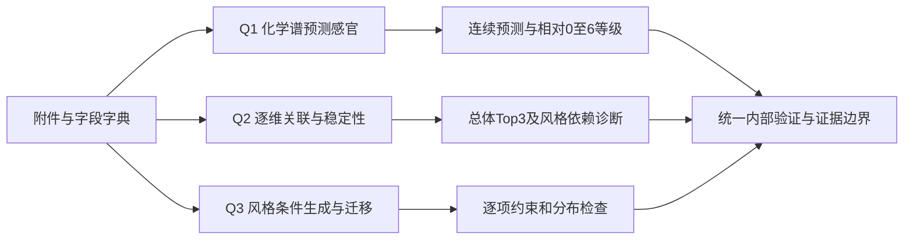

# A题独立审查、改进提案与插件重跑包

审查启动于 2026-10-25，2026-10-26 整理交付。

**建议先修模型的可验证性，再比较能否提高表现。** 原 Q1 有真实可复算的预测收益，值得保留；Q3 已出现负实浓度和实际缺陷增加，应最先修复。新方案已给出数学形式和执行协议，比赛模型尚未重跑，不能宣称已经优于 v5.1。

## 阅读顺序

1. `01_独立复核与修复优先级.md`：哪些结论已从代码和数据确认，哪些仍是待验证判断。
2. `02_改进建模方案.md`：先用直观语言解释三问，再给公式、变量、假设和取舍。
3. `03_插件重跑清单与提示词.md`：重跑顺序、切分、参数、产物、停止/回退条件；最后一节可以直接复制给同学的插件。
4. `experiment_plan.json`：上述主协议的机器可读索引。详尽定义以 02/03 为准。



## 最关键的复核事实

| 项目 | 本轮结果 |
|---|---|
| Q1 原融合留出 MAE | 全50维 0.346567；A/F30维 0.351154，均来自保存结果复算 |
| Q2 附件6名称对齐 | 20/44 化学行和3感官列错位；全部名称对齐后同源排名对照由0.445051变为0.921018 |
| Q3 负实浓度 | 142格，40条生成谱，22个线性校准字段 |
| Q3 迁移 t2n 化学列 | 11个源中6个升高，旧代理不增无法替代它 |
| Q3 目标中心 | 漏减均值，目标均值本身被算出0.604487距离 |
| 新增数据冲突 | 1.csv与校准表存在80格双方正值差异，24款酒/32字段，原因未确定 |

这些数字不是修复后的模型性能。校准冲突也不证明哪份附件一定正确，禁止静默替换。

## 采用的方案裁决

- Q1：比较真正 Ridge、图 Ridge、精确图低秩；有实际收益再加 HGB 融合。0–6 保留“相对等级”语义。
- Q2：修复旧共识作基线；候选总体轨道 T 提供 Top-3，风格调整轨道 W 作诊断，不将不同含义的分数平均。关联不是因果。
- Q3：先保留小样本收缩 Copula；对已声明约束作统一优化。候选优化 226 个非派生变量，五汇总列做有误差记录的统计重建；不冒称已经满足酿造物理恒等式。
- 评估：3次重复的3外折×3内折。旧留出只作历史参照；新内部验证也不是新增外部数据。
- Q1 主接受线：相对简单模型 A/F MAE 改善至少1%，3次重复同向，50维不恶化超过1%，A/F单组不恶化超过2%；另看样本敏感性区间。它们是项目工程规则，不是官方晋级线。

独立统计/物理/数学批评报告保留在包内，供追溯意见；它们出现的备选参数和展示标签不自动成为最终执行要求。**02、03及 experiment_plan.json 是本轮整合后的提案；若与附录建议不同，以这三份主文件为准。**

## 已做与未做

已做：源码逐项核对；两套独立确定性复算；完整感官名称映射；原始校准表冲突审计；两个独立小型矩阵例验证 Q1 精确求解公式；统计与物理视角批评。

未做：修改原仓库、修复后训练、模型性能比较、大规模生成/迁移、正式论文改写、GitHub推送或比赛提交。前期并行子任务用量失败，后续三项独立审查实际完成了报告；末尾追加统计复审调用失败，没有将其算作已完成审查。没有完成完整五视角共识或 skill 的奖项级最终验证。

## 重算本包证据

这些脚本只需读取同学仓库，输出到新目录，不依赖其 `modeling_contract`，也不会运行比赛训练。Python需要 numpy、pandas、openpyxl。路径用实际仓库路径替换：

```bash
python independent_recheck.py --repo /path/to/mathorcup-2026-track-a-solutions --out /path/to/new-audit-output
python physical_review_check.py --repo /path/to/mathorcup-2026-track-a-solutions --out /path/to/new-audit-output
```

`independent_recheck.json` 对应第一套复算与合成小例；`physical_review_evidence.json` 对应物理字段和原始附件核对；各 CSV 给出逐行证据。第二名审查者的 `independent_closed_form_check.json` 为独立数学交叉核验记录。`manifest.json` 仅证明本交付包文件身份；它不是原模型验证通过证书。

本包与原仓库配合使用，不重复打包大数据。需要原始审查材料时，可沿用上一轮的 `MathorCup_A_v5.1_审查资料包.zip`。
